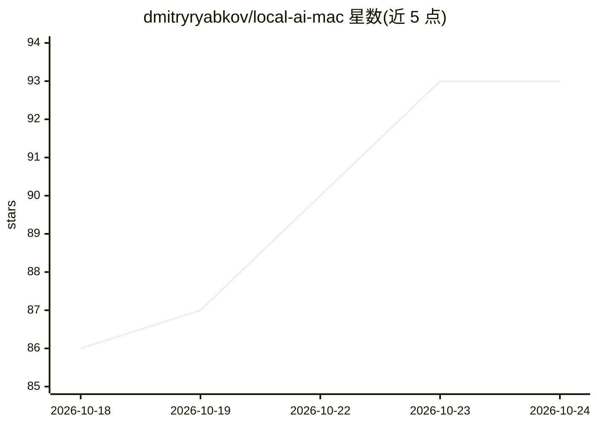

# dmitryryabkov/local-ai-mac

⭐ 95 · MIT · 推送 2026-06-13 · [GitHub](https://github.com/dmitryryabkov/local-ai-mac) · 个人维护

**在 Apple Silicon Mac 上本地运行 LLM 与编码 agent 的实践指南**

个人维护的教程文档，讲解如何在 Mac 上搭建本地 LLM 服务器并用于编码工具与 agent 工作流：从架构决策（推理引擎选型、模型格式 MLX/GGUF、量化级别）、推荐模型到内存与性能权衡。对比 MLX-LM 与 llama.cpp 两种推理引擎及 LM Studio 的适用条件，给出量化精度损失的经验规则（Q8/Q6/Q5/Q4）。需读者已熟悉 LLM 概念与推理引擎，建议 32GB 以上内存。

## 筛选速览

| 维度 | 判定 | 备注 |
|---|---|---|
| AI 角色 | `ai-knowledge` | 知识聚合/清单类 |
| 许可风险 | `permissive` | MIT |
| 部署形态 | `None` |  |
| 模型依赖 | — | README 未给出锁定关系 |
| 硬件要求 | — | 无带数字的原话,不猜 |
| 安装摩擦 | `low` | 无编译、无系统依赖或容器化 |
| 成熟度 | — | 结构信号不足 |

## 能力要点

- 系统讲解推理引擎（MLX-LM/llama.cpp/LM Studio）选型逻辑
- 量化级别（Q8-Q3）与质量损失、内存需求的经验规则
- 覆盖模型类型（Dense/MoE）、MLX 与 GGUF 格式及社区转换来源

## 适用场景

- 把手头闲置的 Mac 变成本地 LLM 服务器
- 在 Mac 上为编码工具和 agent 配置本地模型 API
- 了解本地运行 20-30B 级模型的内存与量化权衡

## 场景标签

`教程课程` · 领域:学习与行业

## 证据(README 行号)

> L2: This is a comprehensive guide on how to run AI models and coding agents locally on a Mac. I gathered various bits an
> L6: > ⚠️ This guide assumes familiarity with LLM concepts, inference engines, and basic system configuration. It is a go

## 星数曲线

2026-10-18 86 → 2026-10-24 93（+7）

---
*卡片 v1 · prompt 1.4 · 生成 2026-10-24 · 置信度 high · 依据 README sha `1999262a590a` · [字段定义](../../DATASET.md)*
