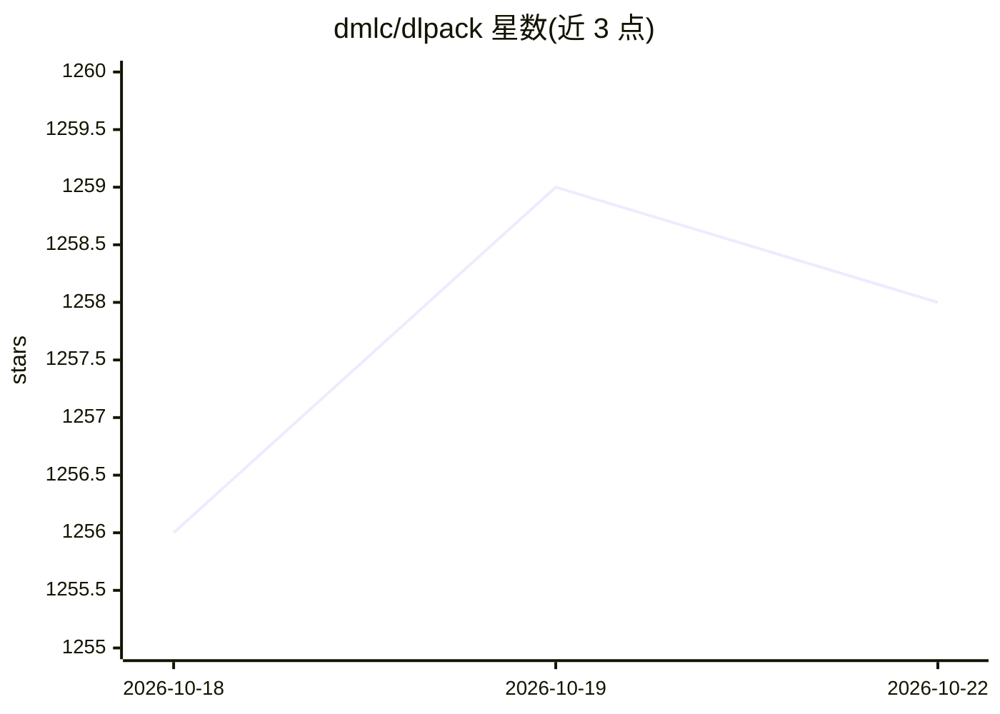

# dmlc/dlpack

⭐ 1,258 · C++ · Apache-2.0 · 推送 2026-08-11 · [GitHub](https://github.com/dmlc/dlpack) · [官网](https://dmlc.github.io/dlpack/latest) · 组织维护

**跨深度学习框架共享张量的开放内存张量结构规范**

DLPack 是一个开放的内存张量数据结构规范，用于在不同深度学习框架之间共享张量。它不实现张量与算子本身，而是作为通用桥梁复用各框架的张量和算子：支持框架间共享算子、封装厂商级算子实现以便引入新设备/算子、快速切换后端实现（如不同版本 BLAS）。通过 RFC 提案与投票机制推进规范演进。项目包含稳定头文件（include）与进行中的库（contrib），由多位深度学习框架社区成员参与设计。

## 筛选速览

| 维度 | 判定 | 备注 |
|---|---|---|
| AI 角色 | `ai-ecosystem` | LLM/agent 周边工具 |
| 许可风险 | `permissive` | Apache-2.0 |
| 部署形态 | `None` |  |
| 模型依赖 | — | README 未给出锁定关系 |
| 硬件要求 | — | 无带数字的原话,不猜 |
| 安装摩擦 | `low` | 无编译、无系统依赖或容器化 |
| 成熟度 | — | 结构信号不足 |

## 能力要点

- 定义跨框架共享张量的开放内存结构
- 不实现 Tensor 与 Ops，仅作为框架间的通用桥梁
- 支持封装厂商级算子实现与切换后端（如不同 BLAS 版本）
- RFC 提案 + 投票发布的规范演进机制

## 适用场景

- 深度学习框架开发者实现张量零拷贝交换
- 为框架接入厂商级算子库与新设备支持
- 需要在不同框架间混合使用算子的场景

## 场景标签

 · 领域:深度学习基础设施/张量互操作规范

## 证据(README 行号)

> L7: DLPack is an open in-memory tensor structure for sharing tensors among frameworks. DLPack enables
> L14: We do not intend to implement Tensor and Ops, but instead use this as common bridge

## 星数曲线

2026-10-18 1,256 → 2026-10-22 1,258（+2）

---
*卡片 v1 · prompt 1.4 · 生成 2026-10-21 · 置信度 high · 依据 README sha `75ef6e273f39` · [字段定义](../../DATASET.md)*
