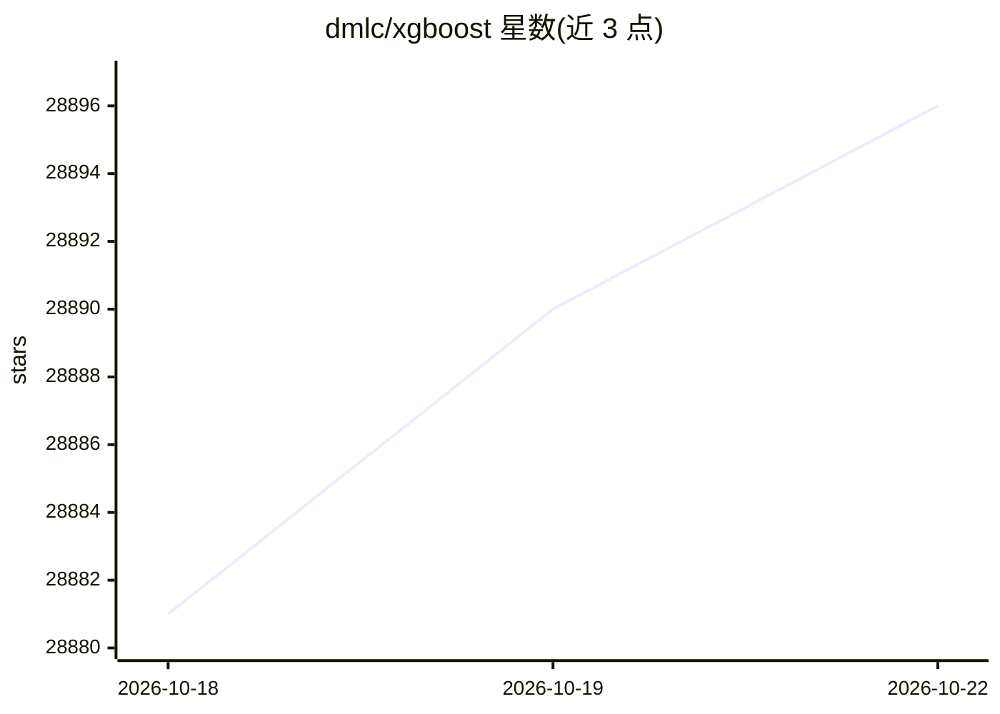

# dmlc/xgboost

⭐ 28,901 · C++ · Apache-2.0 · 推送 2026-10-22 · [GitHub](https://github.com/dmlc/xgboost) · [官网](https://xgboost.readthedocs.io/) · 组织维护

**面向数据科学者的分布式梯度提升树库**

XGBoost 是一个分布式梯度提升库，实现 Gradient Boosting 框架下的机器学习算法，提供并行树提升（GBDT/GBM）。同一份代码可运行在单机及 Kubernetes、Hadoop、SGE、Dask、Spark、PySpark 等分布式环境，可处理超过十亿样本规模的问题。以库形式提供，经 PyPI、Conda、CRAN 等渠道分发，支持 Python、R 等多种语言，源自华盛顿大学研究项目，基于 Apache-2 许可证发布。

## 筛选速览

| 维度 | 判定 | 备注 |
|---|---|---|
| AI 角色 | `ai-ecosystem` | LLM/agent 周边工具 |
| 许可风险 | `permissive` | Apache-2.0 |
| 部署形态 | `library` | 以包/库形式分发 |
| 模型依赖 | — | README 未给出锁定关系 |
| 硬件要求 | — | 无带数字的原话,不猜 |
| 安装摩擦 | `low` | 无编译、无系统依赖或容器化 |
| 成熟度 | — | 结构信号不足 |

## 动量与使用信号

- 维护:`active` — 距上次 push 2.9 天,年发版 9,400 位贡献者
- 涨星:近 1 天 **+1**(自 20261016 起算)
- 下载:GitHub Release 附件 累计 49,718(80 个 release)

## 能力要点

- 并行树提升（GBDT/GBM）实现
- 同一代码运行于 Kubernetes/Hadoop/SGE/Dask/Spark/PySpark 等分布式环境
- 支持 Python、R、Java、Scala、C 等多语言接口
- 支持 Colab 在线运行

## 适用场景

- 在单机或 Spark/Dask 集群上训练梯度提升模型
- 处理十亿级样本的分类回归问题

## 场景标签

`模型训练` · 领域:训练与推理

## 证据(README 行号)

> L20: XGBoost is an optimized distributed gradient boosting library designed to be highly ***efficient***, ***flexible***
> L23: The same code runs on major distributed environment (Kubernetes, Hadoop, SGE, Dask, Spark, PySpark) and can solve p

## 星数曲线

2026-10-18 28,881 → 2026-10-22 28,896（+15）

---
*卡片 v1 · prompt 1.4 · 生成 2026-10-18 · 置信度 high · 依据 README sha `69dfb64ae0a2` · [字段定义](../../DATASET.md)*
