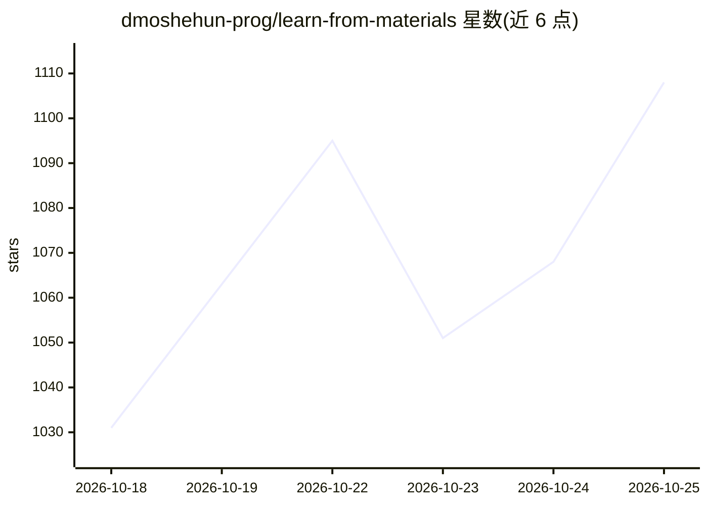

# dmoshehun-prog/learn-from-materials

⭐ 1,132 · Python · MIT · 推送 2026-10-19 · [GitHub](https://github.com/dmoshehun-prog/learn-from-materials) · 个人维护 · 中文 README

**把 PDF/书籍/论文转成可溯源互动学习网页的 agent 技能**

基于开放 Agent Skills 规范（SKILL.md）的跨 agent 学习技能：在可读文件、可运行本地命令的 agent 环境（如 Claude Code、Codex、WorkBuddy、GitHub Copilot CLI）中，把 PDF、EPUB、DOCX、PPTX、网页等多类材料提取为可溯源知识库（.learnkb/）、自包含互动 HTML 学习页与 Markdown。提供快速概览与系统学习两种深度，区分材料事实、未覆盖内容与模型添加内容，做来源哈希校验与细粒度页码映射；默认离线运行、不自动装依赖。纯聊天环境无法执行提取与渲染。

## 筛选速览

| 维度 | 判定 | 备注 |
|---|---|---|
| AI 角色 | `ai-native` | 本体是模型或模型工具 |
| 许可风险 | `permissive` | MIT |
| 部署形态 | `None` |  |
| 模型依赖 | — | README 未给出锁定关系 |
| 硬件要求 | — | 无带数字的原话,不猜 |
| 安装摩擦 | `low` | 无编译、无系统依赖或容器化 |
| 成熟度 | — | 结构信号不足 |

## 能力要点

- 单一顺序工作流生成知识库、互动 HTML 学习页与 Markdown，均出自同一内容数据
- 细粒度来源映射（PDF 页码/PPT 页/EPUB 章节）与来源哈希校验
- 区分材料事实、材料未覆盖内容与模型添加内容，方法库 methods.json 可累积检索
- 默认离线运行，笔记与学习者档案仅存本地浏览器

## 适用场景

- 把教材、论文或行业报告整理成可测验、可做笔记的学习网页
- 在系统学习时核验每个知识点是否有材料出处
- 沉淀并按中英文关键词检索跨材料的方法库

## 场景标签

`知识库管理` `文档解析` · 领域:知识与检索

## 证据(README 行号)

> L13: `learn-from-materials` is a cross-agent learning skill built on the open Agent Skills specification. Systematic stu
> L15: It works in agent environments that can read files, run local commands, and recognize `SKILL.md` — such as WorkBudd

## 星数曲线

2026-10-18 1,031 → 2026-10-25 1,108（+77）

---
*卡片 v1 · prompt 1.4 · 生成 2026-10-21 · 置信度 high · 依据 README sha `739f321609e9` · [字段定义](../../DATASET.md)*
