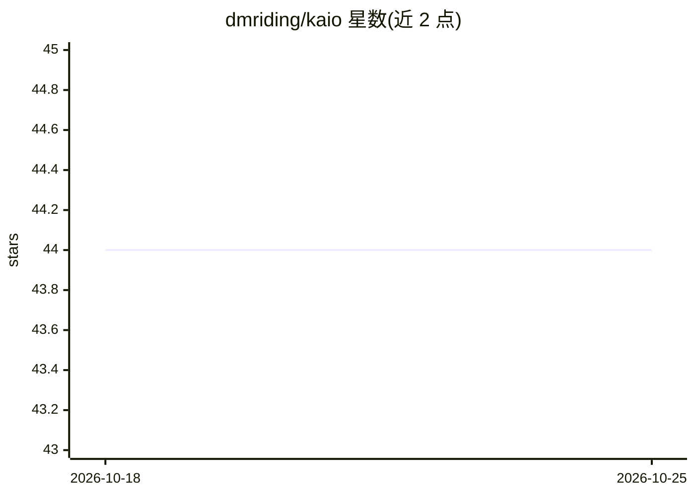

# dmriding/kaio

⭐ 44 · Rust · Apache-2.0 · 推送 2026-06-12 · [GitHub](https://github.com/dmriding/kaio) · [官网](https://crates.io/crates/kaio) · 个人维护

**Rust 原生 GPU kernel 编写框架：Rust 子集 DSL 编译为 PTX**

面向需要自定义 GPU kernel 的 Rust 工程师：通过 `#[gpu_kernel]` 过程宏在编译期将 Rust 子集 DSL 降为 PTX IR，启动时校验 SM target、生成 PTX 文本并交由 CUDA 驱动 JIT 编译。无需安装 CUDA toolkit，仅需 NVIDIA 显示驱动（525+，SM 7.0+），支持 Windows 与 Linux。提供共享内存/warp shuffle/reduction 原语、张量核 matmul（f16/bf16，SM 8.0+）、融合注意力与 FlashAttention，经 `kaio-candle` 集成到 Candle 张量图。非完整 ML 框架：无 autograd、无模型库、kernel 体内不能调用外部 Rust 函数。

## 筛选速览

| 维度 | 判定 | 备注 |
|---|---|---|
| AI 角色 | `ai-ecosystem` | LLM/agent 周边工具 |
| 许可风险 | `permissive` | Apache-2.0 |
| 部署形态 | `library` | 以包/库形式分发 |
| 模型依赖 | — | README 未给出锁定关系 |
| 硬件要求 | — | 无带数字的原话,不猜 |
| 安装摩擦 | `medium` | 含编译或系统依赖之一 |
| 成熟度 | — | 结构信号不足 |

## 能力要点

- `#[gpu_kernel]` 过程宏在编译期将 Rust 子集 DSL 降为 PTX，类型安全签名在编译期捕获 dtype 不匹配
- 无需 CUDA toolkit，仅需 NVIDIA 显示驱动（525+），Windows/Linux 原生支持
- 内置张量核 matmul（f16/bf16/INT8/INT4）、FlashAttention 及 backward 变体
- `kaio-candle` 提供 12 个 CustomOp 绑定接入 Candle 张量图

## 适用场景

- 框架不支持自定义算子时用 Rust 编写融合注意力、量化、新激活等 kernel
- 在 Windows 上无 WSL2 做 GPU 推理 kernel 开发
- 在无 GPU/CUDA 的标准 GitHub runner 上构建并运行宿主测试
- 复制仓库内 showcase 工程作为自己 kernel 的参考模板

## 场景标签

 · 领域:GPU 计算/ML 基础设施

## 证据(README 行号)

> L10: **Write custom GPU kernels in Rust — no CUDA C++, no Python, no toolkit.** KAIO compiles a Rust-subset DSL to PTX a
> L34: - **Pure-Rust kernel authorship.** The `#[gpu_kernel]` proc macro lowers
> L40: - **Drops into Candle's tensor graph** via `kaio-candle` —

## 星数曲线

2026-10-18 44 → 2026-10-25 44（+0）

---
*卡片 v1 · prompt 1.4 · 生成 2026-10-25 · 置信度 high · 依据 README sha `5ddbae9ab36d` · [字段定义](../../DATASET.md)*
