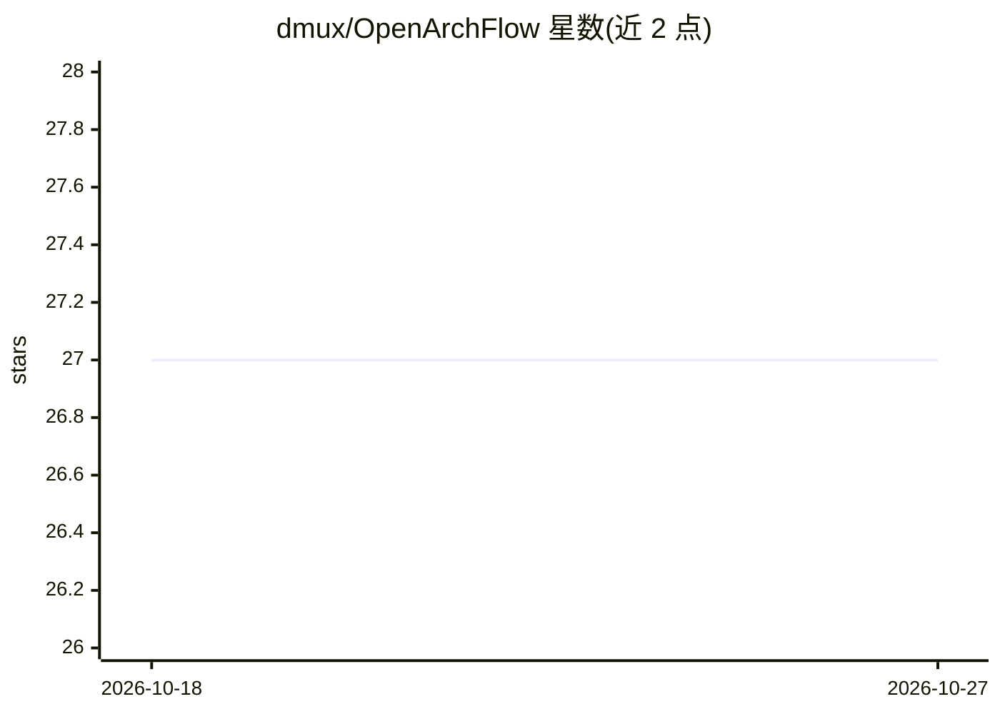

# dmux/OpenArchFlow

⭐ 27 · TypeScript · MIT · 推送 2026-09-23 · [GitHub](https://github.com/dmux/OpenArchFlow) · [官网](https://openarchflow.cloud) · 组织维护

**用自然语言生成 AWS 架构图并部署到本地模拟器的 PWA**

面向云架构师、DevOps 工程师与开发者的开源 PWA：以自然语言描述生成交互式 AWS 架构图，支持多模型（Gemini 云端、AWS Bedrock、浏览器内 WebLLM 本地推理），并可将图导出为 Terraform 代码、一键部署到本地 AWS 模拟器 MiniStack（LocalStack 端口 4566）。附加功能包括实时 P2P 协同（WebRTC+E2EE）、Google Drive 同步、扫描真实 AWS 账号导入（24 种服务）、AWS 定价 API 成本估算。全部在浏览器中运行，无需 AWS 账号。

## 筛选速览

| 维度 | 判定 | 备注 |
|---|---|---|
| AI 角色 | `ai-enhanced` | 去掉 AI 部分产品仍成立 |
| 许可风险 | `permissive` | MIT |
| 部署形态 | `self-host` | docker 或自建部署 |
| 模型依赖 | locked-api |  |
| 硬件要求 | — | 无带数字的原话,不猜 |
| 安装摩擦 | `low` | 无编译、无系统依赖或容器化 |
| 成熟度 | — | 结构信号不足 |

## 能力要点

- 自然语言生成架构图，支持 Gemini / Bedrock / 浏览器内 WebLLM 三种引擎
- 导出生产可用 Terraform（60+ AWS 资源映射，含依赖推断）
- 一键部署到本地 MiniStack AWS 模拟器，含每节点交互控制台
- 扫描真实 AWS 账号 24 种服务资源并自动推断连线，生成图表

## 适用场景

- 从自然语言描述快速起草 AWS 架构方案并调整
- 本地模拟环境里低成本验证与测试架构
- 把架构设计转成 Terraform 代码用于实际部署
- 对现有 AWS 账号资源扫描并整理成图与成本估算

## 场景标签

`代码生成` · 领域:编码与开发

## 证据(README 行号)

> L22: OpenArchFlow is an **open-source Progressive Web App** designed for cloud architects, DevOps engineers, and develop
> L30: - 🔧 **Fully Editable**: AI generates the initial design, you refine it with drag-and-drop.
> L64: - **Cloud AI (Gemini)**: Choose between **Gemini 2.0 Flash** (fastest), **Gemini 2.5 Flash** (balanced, default), o

## 星数曲线

2026-10-18 27 → 2026-10-27 27（+0）

---
*卡片 v1 · prompt 1.4 · 生成 2026-10-26 · 置信度 high · 依据 README sha `5e395cbb22e5` · [字段定义](../../DATASET.md)*
