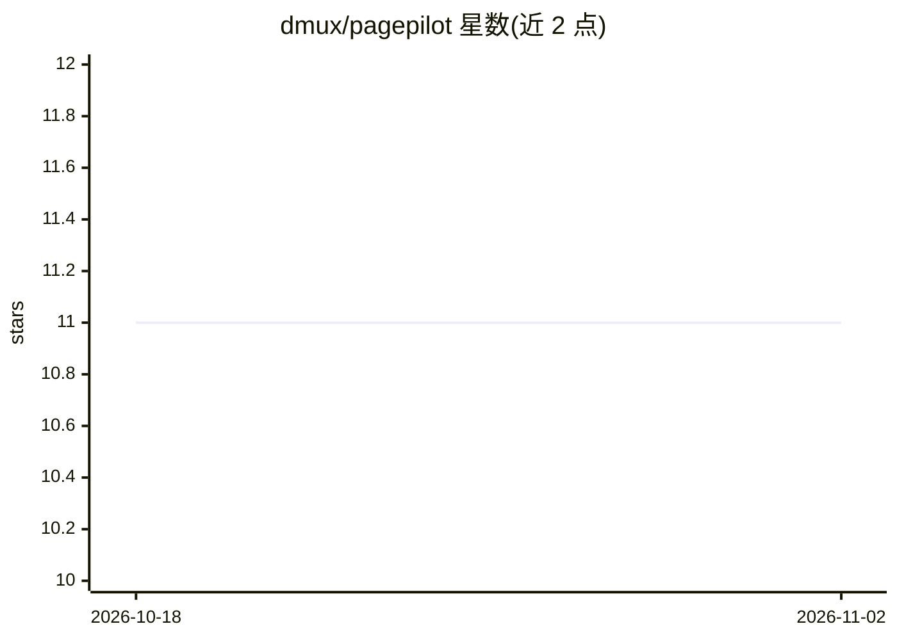

# dmux/pagepilot

⭐ 11 · TypeScript · MIT · 推送 2026-05-09 · [GitHub](https://github.com/dmux/pagepilot) · [官网](https://dmux.github.io/pagepilot/) · 组织维护

**VS Code Chat 扩展：自动加载外部文档为问答注入上下文**

VS Code Chat participant 扩展，通过 /docs、/load 等命令管理多个文档来源，从任意 URL 加载 README、API 文档、llms.txt 等内容，并在提问时以轻量 RAG（BoW/TF-IDF 嵌入、余弦相似度、top-K 分块注入）将相关段落注入 LLM 提示词。上下文按工作区本地持久化，不收集遥测数据。要求 VS Code 1.105.0+ 与网络连接，Chat 依赖内置 Copilot 功能。面向使用 VS Code Chat 的开发者。

## 筛选速览

| 维度 | 判定 | 备注 |
|---|---|---|
| AI 角色 | `ai-ecosystem` | LLM/agent 周边工具 |
| 许可风险 | `permissive` | MIT |
| 部署形态 | `None` |  |
| 模型依赖 | — | README 未给出锁定关系 |
| 硬件要求 | — | 无带数字的原话,不猜 |
| 安装摩擦 | `low` | 无编译、无系统依赖或容器化 |
| 成熟度 | — | 结构信号不足 |

## 能力要点

- 从任意 URL 加载文档/API/README，自动发现 llms.txt 等相关文件
- 轻量 RAG：BoW 嵌入+余弦相似度选 top-K 分块动态注入提示词
- /docs 多文档源管理与工作区级持久存储
- 英/巴葡双语自动检测，零遥测数据收集

## 适用场景

- 在 VS Code Chat 中直接提问所加载 API 文档的内容
- 为项目维护多个文档来源并在其间切换
- 让 AI 回答自带外部技术文档依据而无需切换浏览器

## 场景标签

`RAG` `文档问答` · 领域:知识与检索

## 证据(README 行号)

> L8: PagePilot is a VS Code Chat participant that automatically loads external context (documentation, APIs, README files
> L85: ## 🧠 RAG — Retrieval-Augmented Generation (implementation)
> L87: PagePilot includes a lightweight RAG (Retrieval-Augmented Generation) implementation to enrich prompts sent to the 

## 星数曲线

2026-10-18 11 → 2026-11-02 11（+0）

---
*卡片 v1 · prompt 1.4 · 生成 2026-11-02 · 置信度 high · 依据 README sha `d15dedd5c389` · [字段定义](../../DATASET.md)*
