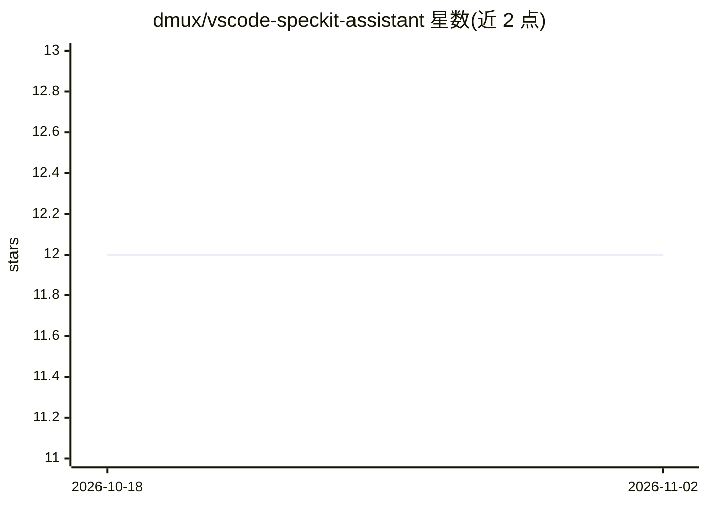

# dmux/vscode-speckit-assistant

⭐ 12 · TypeScript · MIT · 推送 2026-05-09 · [GitHub](https://github.com/dmux/vscode-speckit-assistant) · [官网](https://marketplace.visualstudio.com/items?itemName=rfsales.speckit-assistant) · 组织维护

**VS Code 内可视化编排 Spec Kit 规范驱动开发流程的扩展**

面向使用 Spec Kit 做规范驱动开发（SDD）的开发者的 VS Code 扩展：在侧边栏提供 Constitution→Specification→Planning→Tasks→Implementation 五阶段的引导式流程，每阶段有审查门与状态流转；支持全屏 DAG 工作流图、内联任务清单（写回 tasks.md）、过期阶段告警、澄清模板与 AI 终端输出的实时面板（含快捷回复）。可通过一项设置切换 claude/gemini/copilot/openai 四种 AI 后端 CLI。要求 VS Code ^1.93.0、specify CLI 在 PATH 中且至少配置一个 AI CLI。

## 筛选速览

| 维度 | 判定 | 备注 |
|---|---|---|
| AI 角色 | `ai-ecosystem` | LLM/agent 周边工具 |
| 许可风险 | `permissive` | MIT |
| 部署形态 | `library` | 以包/库形式分发 |
| 模型依赖 | locked-api |  |
| 硬件要求 | — | 无带数字的原话,不猜 |
| 安装摩擦 | `low` | 无编译、无系统依赖或容器化 |
| 成熟度 | — | 结构信号不足 |

## 能力要点

- 五阶段 SDD 工作流与 idle→running→awaiting review→approved 状态流转
- 全屏交互式 DAG 工作流图，含任务进度条与状态配色
- 内联任务清单勾选直接写回 tasks.md，实时同步进度
- 一键切换 claude/gemini/copilot/openai AI 后端

## 适用场景

- 在 VS Code 内跑完整 Spec Kit 规范驱动开发流程
- 通过 DAG 图查看项目各功能阶段与任务进度
- 从侧边栏直接回应 AI 终端提示并管理阶段审查

## 场景标签

 · 领域:开发者工具/软件开发

## 证据(README 行号)

> L9: Spec Kit Assistant gives you a guided phase-by-phase workflow in the sidebar — from constitution to implementation —
> L19: - Switch AI backends (`claude`, `gemini`, `copilot`, `openai`) with one setting.
> L91: - `specify` CLI available in your shell PATH

## 星数曲线

2026-10-18 12 → 2026-11-02 12（+0）

---
*卡片 v1 · prompt 1.4 · 生成 2026-11-01 · 置信度 mid · 依据 README sha `25018f1da872` · [字段定义](../../DATASET.md)*
