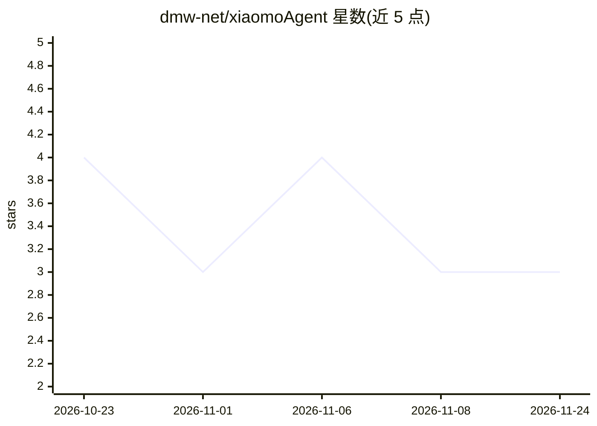

# dmw-net/xiaomoAgent

⭐ 3 · TypeScript · Apache-2.0 · 推送 2026-11-19 · [GitHub](https://github.com/dmw-net/xiaomoAgent) · [官网](https://github.com/dmw-net/xiaomoAgent/releases/latest) · 个人维护 · 中文 README

**Windows 本地优先陪伴型 AI Agent，支持长期记忆与主动对话**

基于 Tauri + SQLite 的桌面陪伴型 Agent：聊天记录、记忆与媒体均保存在本机，模型由用户自配（任何 OpenAI 兼容服务）。核心机制包括按私聊/QQ 群分空间的「关系事件」长期记忆、可查可取消的主动性计划、多联系人独立人设，以及语音识别/合成、图片理解、图像生成等按能力分别接模型的配置。用户需自备 API Key；桌面版仅支持 Windows 10/11 64 位，手机可通过同 Wi-Fi 浏览器访问。

## 筛选速览

| 维度 | 判定 | 备注 |
|---|---|---|
| AI 角色 | `ai-native` | 本体是模型或模型工具 |
| 许可风险 | `permissive` | Apache-2.0 |
| 部署形态 | `library` | 以包/库形式分发 |
| 模型依赖 | local-ok | 支持本地模型 |
| 硬件要求 | — | 无带数字的原话,不猜 |
| 安装摩擦 | `low` | 无编译、无系统依赖或容器化 |
| 成熟度 | — | 结构信号不足 |

## 能力要点

- 长期记忆按私聊与 QQ 群分别保存，可查看召回边界
- 主动对话为一条条可查、可取消的计划，夜间不打扰、每日有上限
- 表情与媒体统一进媒体库，支持语义搜索与来源追踪
- 不提供模型，需自配任何 OpenAI 兼容服务的 API Key

## 适用场景

- 在本地保存聊天记录的前提下运行 QQ/微信陪伴型聊天机器人
- 让 AI 记住你提过的事并在合适时机主动找你
- 用自己选择的服务商接入对话、语音、图像等能力模型

## 场景标签

`聊天机器人` `Agent 记忆` `图像生成` · 领域:Agent 开发

## 证据(README 行号)

> L5:  记得住事，也会主动找你的陪伴型 Agent。
> L29: 小茉用你的模型说话，但**记得住你们之间发生过什么**，也会在你没主动开口的时候出现。
> L124: 是的，小茉本身不提供模型，你用自己的 API Key（任何 OpenAI 兼容的服务都行）。好处是数据只经过你自己选的服务商。

## 星数曲线

2026-10-23 4 → 2026-11-24 3（-1）

---
*卡片 v1 · prompt 1.4 · 生成 2026-11-22 · 置信度 high · 依据 README sha `123ee303dd65` · [字段定义](../../DATASET.md)*
