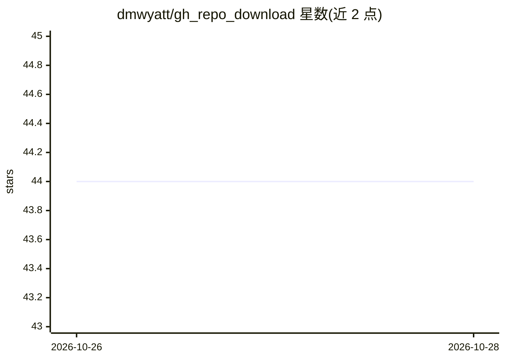

# dmwyatt/gh_repo_download

⭐ 44 · Python · 推送 2026-10-24 · [GitHub](https://github.com/dmwyatt/gh_repo_download) · [官网](https://gh-repo-dl.cottonash.com/) · 个人维护

**把 GitHub 仓库或 ZIP 文件合成单个文本文件的 Django 网页工具**

Django 网页应用：输入 GitHub 仓库 URL 或上传 ZIP 文件，抽取其中的纯文本文件并拼接为单个文本文件供下载，便于将代码或文档作为上下文分享给 LLM 聊天机器人。基于 zlib 算法判断纯文本文件，支持编码声明检测；token 计数在浏览器端通过 WASM 版 tiktoken 完成。全流程在内存中处理，不写磁盘。限制：仓库/ZIP 最大 10 MB、最多处理 1000 个文件、最多交付 10 MB 文本。开发者需用 uv 与 Node.js 20+ 从源码运行。

## 筛选速览

| 维度 | 判定 | 备注 |
|---|---|---|
| AI 角色 | `ai-ecosystem` | LLM/agent 周边工具 |
| 许可风险 | `none` | — |
| 部署形态 | `desktop` | 安装包/桌面程序 |
| 模型依赖 | — | README 未给出锁定关系 |
| 硬件要求 | — | 无带数字的原话,不猜 |
| 安装摩擦 | `low` | 无编译、无系统依赖或容器化 |
| 成熟度 | — | 结构信号不足 |

## 能力要点

- GitHub 仓库 URL 或本地 ZIP 合成单个文本文件
- 浏览器端 WASM tiktoken 做 token 计数
- zlib 算法判定纯文本文件与编码声明检测
- 全内存处理，不写磁盘，不解压 ZIP 到磁盘

## 适用场景

- 把仓库源码作为上下文发给 ChatGPT/Claude 等聊天机器人讨论
- 将含文档或论文的仓库整理为单文件供 AI 阅读
- 快速导出仓库中全部纯文本文件便于粘贴分享

## 场景标签

 · 领域:开发者工具/LLM 上下文准备

## 证据(README 行号)

> L9: This tool was created to make it easy to share context with LLM chatbots like ChatGPT,
> L10: Claude, and Gemini. By downloading a GitHub repository or uploading a ZIP file as a single
> L31: We provide a token count for the text file. The

## 星数曲线

2026-10-26 44 → 2026-10-28 44（+0）

---
*卡片 v1 · prompt 1.4 · 生成 2026-10-25 · 置信度 mid · 依据 README sha `7be68e712879` · [字段定义](../../DATASET.md)*
