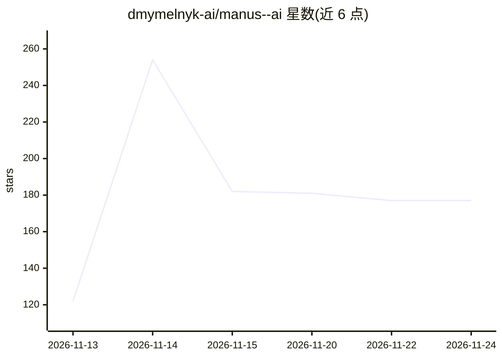

# dmymelnyk-ai/manus--ai

⭐ 177 · Apache-2.0 · 推送 2026-11-15 · [GitHub](https://github.com/dmymelnyk-ai/manus--ai) · 个人维护

**自主 AI Agent：代替用户执行代码与控制浏览器完成多步任务**

面向学生、远程办公者与小项目用户的自主 AI 代理：用户以自然语言下达指令，代理自行编写并执行脚本、打开网页、填写表单、跨代码与浏览器完成多步骤任务，可在后台以个人助手形式待命并跨会话复用已习得的工作流。README 定位其为家庭、学习与轻量办公场景的助手，非企业级平台；给出了系统兼容性要求（4GB 内存起步，推荐 8GB）与六步上手流程，但未提供具体的安装命令、模型接入方式或代码仓库结构说明。

## 筛选速览

| 维度 | 判定 | 备注 |
|---|---|---|
| AI 角色 | `ai-native` | 本体是模型或模型工具 |
| 许可风险 | `permissive` | Apache-2.0 |
| 部署形态 | `None` |  |
| 模型依赖 | — | README 未给出锁定关系 |
| 硬件要求 | — | 无带数字的原话,不猜 |
| 安装摩擦 | `low` | 无编译、无系统依赖或容器化 |
| 成熟度 | — | 结构信号不足 |

## 能力要点

- 自主执行代码，代理自行编写并运行脚本完成任务
- 浏览器控制：导航网站、填写表单、跨页面收集信息
- 代码与浏览器在同一任务流中衔接（脚本起、浏览器收）
- 后台待命的个人助手模式，跨会话复用工作流

## 适用场景

- 让学生组织研究笔记、运行小脚本
- 远程工作者从多个网页收集数据并准备摘要
- 把重复性的小任务委托给代理后台处理
- 开发时快速运行小实验而无需搭建完整环境

## 场景标签

`工作流自动化` `AI 助手` `浏览器自动化` `编码 Agent` · 领域:效率与自动化

## 证据(README 行号)

> L10: - **Autonomous Code Execution:** Manus AI agent runs code on its own to complete tasks, so you can focus on decisio
> L18: Manus is an autonomous AI agent designed to run code and control a browser on your behalf. Instead of acting like a

## 星数曲线

2026-11-13 122 → 2026-11-24 177（+55）

---
*卡片 v1 · prompt 1.4 · 生成 2026-11-17 · 置信度 mid · 依据 README sha `67c3d4d92b69` · [字段定义](../../DATASET.md)*
