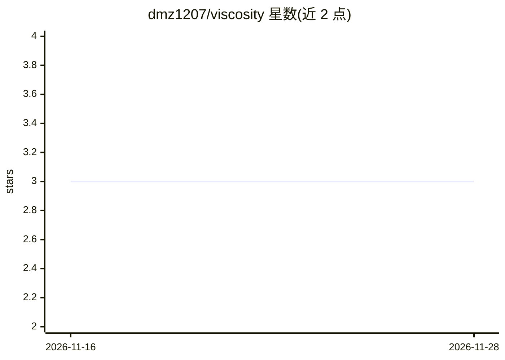

# dmz1207/viscosity

⭐ 3 · TeX · 推送 2026-10-30 · [GitHub](https://github.com/dmz1207/viscosity) · [官网](https://github.com/dmz1207/viscosity) · 个人维护 · 中文 README

**探讨智能为何难以改变现实的书：资源/时间/拓扑框架**

Ming-Zhe Dai（中南大学副教授）所著书籍《Viscosity》的仓库，提供英文与中文 PDF 下载。书提出

## 筛选速览

| 维度 | 判定 | 备注 |
|---|---|---|
| AI 角色 | `ai-knowledge` | 知识聚合/清单类 |
| 许可风险 | `none` | — |
| 部署形态 | `None` |  |
| 模型依赖 | — | README 未给出锁定关系 |
| 硬件要求 | — | 无带数字的原话,不猜 |
| 安装摩擦 | `low` | 无编译、无系统依赖或容器化 |
| 成熟度 | — | 结构信号不足 |

## 能力要点

- 资源R·时间T·拓扑G三维约束分析框架
- 覆盖信息、物质、生命三个层面的对照矩阵
- 英文与中文双版本 PDF 提供
- 通过 GitHub Issues 开放案例与数据征集

## 适用场景

- 理解 AI 能力跃迁为何未带来同幅度的现实改变
- 分析某行业/机构采纳新技术的瓶颈约束
- 为技术变革的定性分析寻找结构化框架

## 场景标签

 · 领域:科技哲学/复杂系统

## 证据(README 行号)

> L35: *Viscosity* proposes a meta-concept for technological change: **viscosity**, the generalized damping intelligence e
> L49: The framework is applied across **bits, atoms, and genes**, examining intelligence in information, matter, and life
> L101: **First edition** · English PDF · 中文 PDF · Downloads

## 星数曲线

2026-11-16 3 → 2026-11-28 3（+0）

---
*卡片 v1 · prompt 1.4 · 生成 2026-11-22 · 置信度 high · 依据 README sha `a93d57c31bb5` · [字段定义](../../DATASET.md)*
