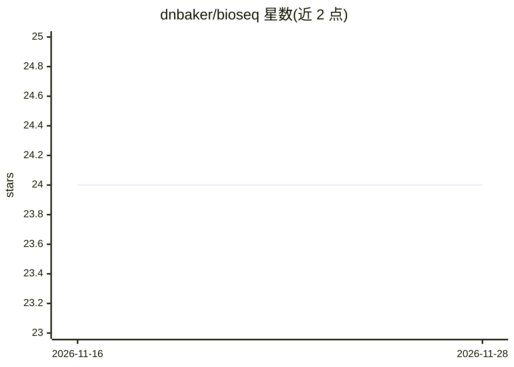

# dnbaker/bioseq

⭐ 24 · C++ · 推送 2026-11-16 · [GitHub](https://github.com/dnbaker/bioseq) · 个人维护

**生物序列（DNA/蛋白质）快速分词与 one-hot 编码库**

C++/Python 实现的生物序列编码库：提供 4 字母 DNA、20 字母氨基酸及多种压缩字母表的 Tokenizer，支持 BOS/EOS/填充字符组合、批并行 tokenize 与 one-hot 编码，可转换为 pytorch 张量并移动到设备。附带 FlatFile 随机访问 FASTQ/FASTA 与 Dataset 封装、BLOSUM62 随机突变数据增强。one-hot 编码不支持 batch_first、压缩字母表解码取字典序最小代表字符为其已知限制。依赖 pybind11、numpy、pytorch。

## 筛选速览

| 维度 | 判定 | 备注 |
|---|---|---|
| AI 角色 | `ai-ecosystem` | LLM/agent 周边工具 |
| 许可风险 | `none` | — |
| 部署形态 | `library` | 以包/库形式分发 |
| 模型依赖 | — | README 未给出锁定关系 |
| 硬件要求 | — | 无带数字的原话,不猜 |
| 安装摩擦 | `low` | 无编译、无系统依赖或容器化 |
| 成熟度 | — | 结构信号不足 |

## 能力要点

- 多字母表 Tokenizer，支持 BOS/EOS/填充字符组合
- 可并行（nthreads）的 batch_tokenize 与 batch_onehot_encode
- FlatFile/FlatFileDataset 提供 FASTQ/FASTA 随机访问并对接 torch DataLoader
- BLOSUM62 概率随机突变的数据增强（仅限完整 20 氨基酸字母表）

## 适用场景

- 为 Transformer/CNN/LSTM 训练准备生物序列 token 或 one-hot 输入
- 快速随机读取大 FASTQ/FASTA 文件做 PyTorch 数据加载
- 蛋白质序列做基于 BLOSUM62 的数据增强

## 场景标签

`模型训练` · 领域:训练与推理

## 证据(README 行号)

> L3: A C++/Python package performing fast one-hot encoding for DNA or Protein sequences with C++ code, optionally convert
> L27: 1. To train Transformers, you need to use `batch_first=True`, followed by torch.nn.Embedding.
> L63: This is then used by bioseq.FlatFileDataset for use with torch.utils.data.DataLoader.

## 星数曲线

2026-11-16 24 → 2026-11-28 24（+0）

---
*卡片 v1 · prompt 1.4 · 生成 2026-11-18 · 置信度 high · 依据 README sha `8136f7631ebb` · [字段定义](../../DATASET.md)*
