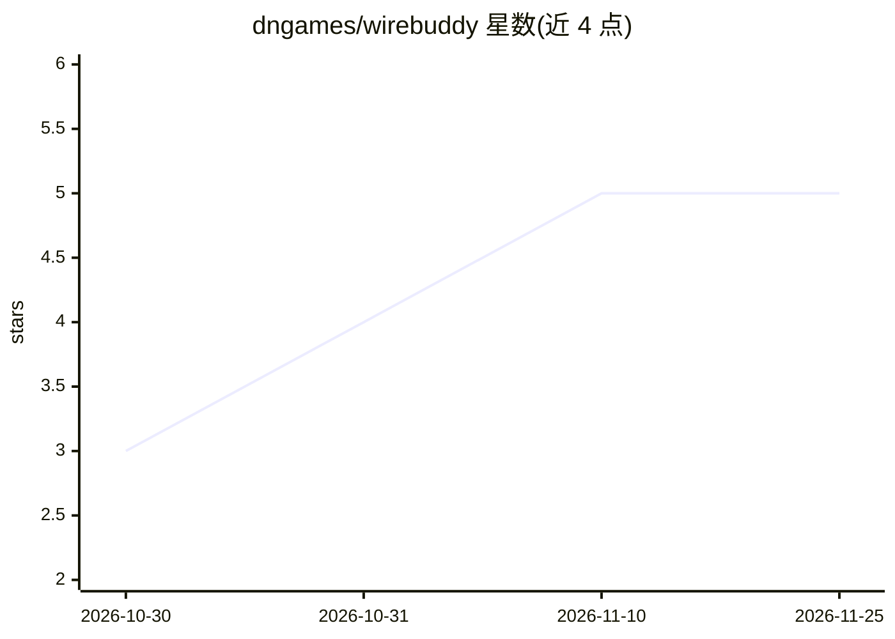

# dngames/wirebuddy

⭐ 5 · TypeScript · MIT · 推送 2026-11-17 · [GitHub](https://github.com/dngames/wirebuddy) · [官网](https://www.npmjs.com/package/wirebuddy) · 个人维护

**供人与 AI agent 共用的浏览器端 Wireshark 风格包分析器**

WireBuddy 在浏览器中提供 Wireshark 风格的包查看界面，通过 MCP 让 AI agent 与用户操作同一视图：agent 的过滤器、标记、选中包实时同步给人，右键可就选中包向 agent 提问。对 Wireshark 无法解码的协议，agent 可编写 Lua dissector 并加载测试，还可编写沙箱面板绘制图像、视频、点云等。解码由 Wireshark 的 sharkd 引擎完成，支持 TLS 解密、实时抓包、findings 报告导出。运行依赖 Wireshark 4.6 与 Node.js ≥22，Linux 为主，macOS 仅 CI 验证，Windows 未测试。

## 筛选速览

| 维度 | 判定 | 备注 |
|---|---|---|
| AI 角色 | `ai-enhanced` | 去掉 AI 部分产品仍成立 |
| 许可风险 | `permissive` | MIT |
| 部署形态 | `library` | 以包/库形式分发 |
| 模型依赖 | — | README 未给出锁定关系 |
| 硬件要求 | — | 无带数字的原话,不猜 |
| 安装摩擦 | `low` | 无编译、无系统依赖或容器化 |
| 成熟度 | — | 结构信号不足 |

## 能力要点

- agent 与用户共享同一包视图，过滤器/标记/选中状态双向同步
- agent 生成 Lua dissector 解码未知协议并编写沙箱可视化面板
- 解码由 Wireshark sharkd 引擎执行，支持 Open in Wireshark 跳转 GUI
- 通过 dumpcap 支持实时抓包，pcapng 导出保留标记与注释

## 适用场景

- 与 AI agent 协作排查网络故障并核验其结论
- 为公司私有传感器流或游戏协议生成解码器
- 让 agent 就选中包回答问题并产出调查报告
- 解密 TLS 流量查看 HTTP/2 等内层协议

## 场景标签

`网络安全` · 领域:学习与行业

## 证据(README 行号)

> L12: WireBuddy is a Wireshark-style packet viewer in a browser tab, built to sit next to an AI chat
> L13: (for example in the Claude Code desktop app's browser pane). The agent works the viewer over MCP
> L31: - **Wireshark's own decoding.** Everything is dissected by Wireshark's engine (`sharkd`), with

## 星数曲线

2026-10-30 3 → 2026-11-25 5（+2）

---
*卡片 v1 · prompt 1.4 · 生成 2026-11-21 · 置信度 high · 依据 README sha `a26a974c76d5` · [字段定义](../../DATASET.md)*
