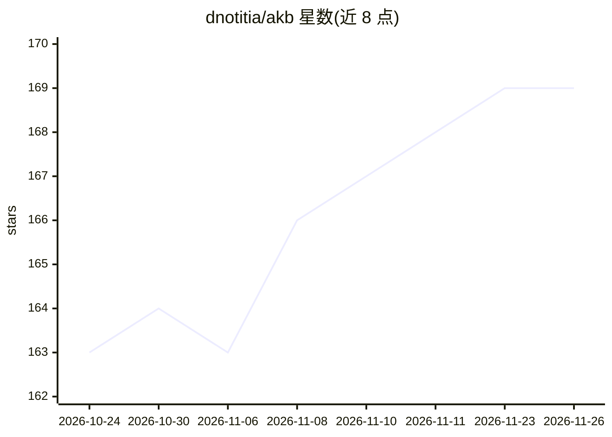

# dnotitia/akb

⭐ 169 · Python · NOASSERTION · 推送 2026-11-25 · [GitHub](https://github.com/dnotitia/akb)

**面向 AI agent 的 MCP 知识库：文档/表格/文件统一存取与检索**

以 PostgreSQL 为源头的知识库，通过 MCP 服务器与 REST API 对外提供，供 agent 直接读写文档、表格与文件附件。核心机制包括混合检索（稠密向量 + BM25 经 RRF 融合）、frontmatter 关系构成的 URI 知识图谱、基于 PostgreSQL ACL 的 vault 级隔离、版本历史与修订。接入方式为 HTTP /mcp/ 端点或 npm 包 akb-mcp 提供的 stdio 代理，并为 Claude Code 与 Codex 提供生命周期插件。许可为 BSL 1.1，可经 Docker Compose 或 Kubernetes 自托管。

## 筛选速览

| 维度 | 判定 | 备注 |
|---|---|---|
| AI 角色 | `ai-ecosystem` | LLM/agent 周边工具 |
| 许可风险 | `none` | NOASSERTION |
| 部署形态 | `self-host` | docker 或自建部署 |
| 模型依赖 | — | README 未给出锁定关系 |
| 硬件要求 | — | 无带数字的原话,不猜 |
| 安装摩擦 | `low` | 无编译、无系统依赖或容器化 |
| 成熟度 | — | 结构信号不足 |

## 能力要点

- 混合检索：dense + BM25 经 RRF 融合，单次调用返回
- frontmatter relations 构成显式 URI 知识图谱
- 基于 PostgreSQL ACL 的 vault 级权限隔离与版本历史
- 面向 Claude Code / Codex 的 agent 插件与 npm stdio 代理

## 适用场景

- 让编码 agent 把会话笔记与决策沉淀进团队知识库
- 替换人工点击型文档工具，供 MCP agent 读写组织知识
- 多租户/多 vault 场景下按权限共享与发布文档

## 场景标签

`知识库管理` `知识图谱` · 领域:知识与检索

## 证据(README 行号)

> L5: > **Organizational memory for AI agents.** PostgreSQL-native knowledge base served
> L6: > over the **Model Context Protocol (MCP)** — agents read and write directly
> L17: Any agent client that speaks **MCP (Streamable HTTP or stdio)**:

## 星数曲线

2026-10-24 163 → 2026-11-26 169（+6）

---
*卡片 v1 · prompt 1.4 · 生成 2026-11-26 · 置信度 mid · 依据 README sha `0d845e96121f` · [字段定义](../../DATASET.md)*
