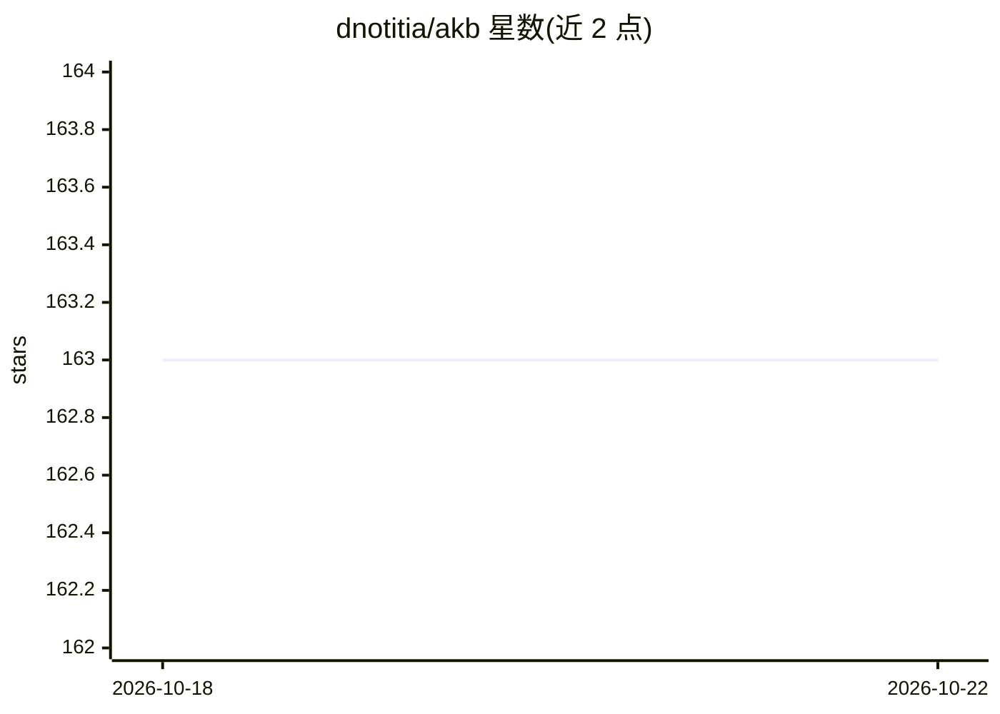

# dnotitia/akb

⭐ 163 · Python · NOASSERTION · 推送 2026-10-22 · [GitHub](https://github.com/dnotitia/akb) · 组织维护

**面向 AI agent 的组织知识库服务，经 MCP 读写文档/表格/文件**

PostgreSQL 原生的知识库服务，通过 Model Context Protocol（MCP Streamable HTTP / stdio）向 Claude Code、Claude Desktop、Cursor、Windsurf 等 agent 客户端提供读写工具：文档 CRUD、文件与图片附件、表格与 SQL、URI 知识图谱、混合检索（dense + BM25 经 RRF 融合，LongMemEval-S 上 Recall@5 = 98.4%）、修订历史与基于 PostgreSQL ACL 的 vault 级权限隔离。另提供 Claude Code / Codex 插件（wiki 摄入、会话记录、生命周期桥接）与公开演示站。自部署需 Docker Compose 或 Kubernetes，许可为 BSL 1.1。

## 筛选速览

| 维度 | 判定 | 备注 |
|---|---|---|
| AI 角色 | `ai-ecosystem` | LLM/agent 周边工具 |
| 许可风险 | `none` | NOASSERTION |
| 部署形态 | `self-host` | docker 或自建部署 |
| 模型依赖 | locked-api |  |
| 硬件要求 | — | 无带数字的原话,不猜 |
| 安装摩擦 | `low` | 无编译、无系统依赖或容器化 |
| 成熟度 | — | 结构信号不足 |

## 能力要点

- MCP 工具集：文档 CRUD、表格 + SQL、文件/图片附件、URI 知识图谱
- 混合检索（dense + BM25 经 RRF 融合），LongMemEval-S 报告 Recall@5 = 98.4%
- vault 隔离由 PostgreSQL ACL 与 SET LOCAL ROLE 强制，跨 vault 访问返回 42501
- 官方 agent 插件：akb-wiki / akb-sessions / akb-claude-code 生命周期桥接

## 适用场景

- 让 Claude Code / Cursor 等编码 agent 拥有跨会话的组织记忆库
- 团队用统一 vault 管理文档、表格与文件并控制读写权限
- 通过 outbox + Redis Stream 事件接外部整理/摘要/审计消费者

## 场景标签

`知识库管理` `知识图谱` `RAG` · 领域:知识与检索

## 证据(README 行号)

> L5: > **Organizational memory for AI agents.** PostgreSQL-native knowledge base served
> L6: > over the **Model Context Protocol (MCP)** — agents read and write directly
> L8: > graph. Drop-in alternative to Confluence / Notion for Claude Code, Cursor,

## 星数曲线

2026-10-18 163 → 2026-10-22 163（+0）

---
*卡片 v1 · prompt 1.4 · 生成 2026-10-22 · 置信度 high · 依据 README sha `2868394d52de` · [字段定义](../../DATASET.md)*
