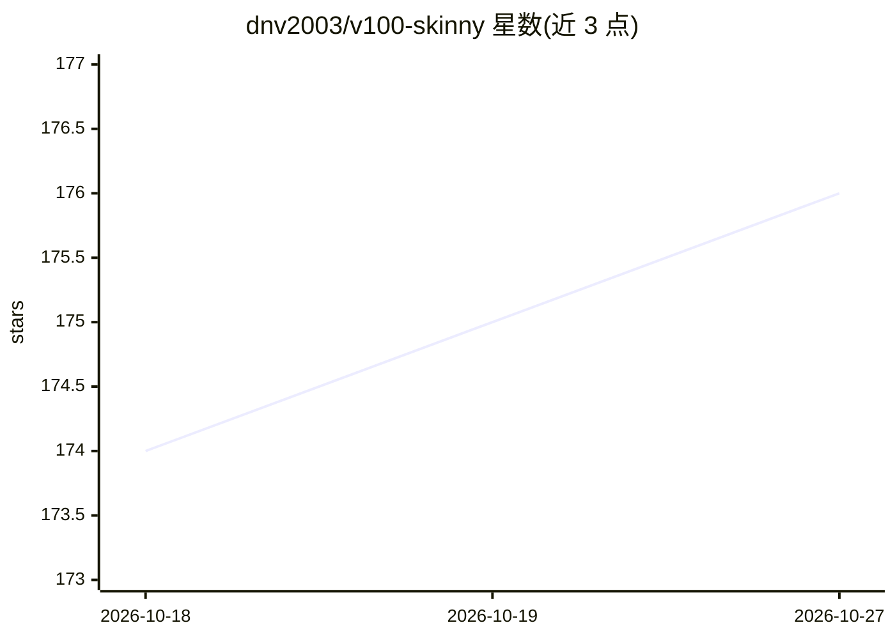

# dnv2003/v100-skinny

⭐ 176 · Python · NOASSERTION · 推送 2026-08-19 · [GitHub](https://github.com/dnv2003/v100-skinny) · 个人维护

**手写 NVFP4/FP8 CUDA 内核，让 V100 四卡推理 Qwen3.8**

面向 Tesla V100-SXM2-16GB ×4（SM70）的推理引擎：以手写 W4A16（QPN2）与 W8A16（QPN8）内核围绕 Volta 的 mma.sync.m8n8k4 运行 Qwen3.8-27B 已发布的 NVFP4/FP8 混合权重，无需重量化或 FP16 权重副本，采用 FP16 激活与 KV cache，配合投机解码（MTP，k=3/7/15 可选）提供 OpenAI 兼容的推理服务端点。基于 1Cat-vLLM 1.2.2 wheel 与 tilelang 构建，需 CUDA 12.8+。发布含与 RTX 5090 + NInfer 的同实验室解码吞吐对比数据，并声明该结果非普适。

## 筛选速览

| 维度 | 判定 | 备注 |
|---|---|---|
| AI 角色 | `ai-ecosystem` | LLM/agent 周边工具 |
| 许可风险 | `none` | NOASSERTION |
| 部署形态 | `None` |  |
| 模型依赖 | local-ok | 支持本地模型 |
| 硬件要求 | — | 无带数字的原话,不猜 |
| 安装摩擦 | `medium` | 含编译或系统依赖之一 |
| 成熟度 | — | 结构信号不足 |

## 能力要点

- QPN2 (W4A16) / QPN8 (W8A16) 手写内核，直接执行已发布 NVFP4/FP8 混合权重
- 投机解码（MTP）深度 k=3/7/15 为启动时设置，greedy drafting 默认
- OpenAI 兼容 serving 端点
- bootstrap 脚本固定 wheel URL 与 SHA256 并校验

## 适用场景

- 在二手 V100 四卡上运行 Qwen3.8 NVFP4 权重做本地推理服务
- 低成本搭建 OpenAI 兼容的 LLM 端点
- 结构化抽取类工作负载用 k=15 深度提升吞吐

## 场景标签

`推理引擎` `模型量化` · 领域:训练与推理

## 证据(README 行号)

> L8: (W4A16) and FP8 regions through **QPN8** (W8A16), both hand-written around
> L10: weight copy. FP16 activations and FP16 KV cache. OpenAI-compatible serving —
> L232: 1Cat-vLLM 1.2.2 wheel. The bootstrap

## 星数曲线

2026-10-18 174 → 2026-10-27 176（+2）

---
*卡片 v1 · prompt 1.4 · 生成 2026-10-22 · 置信度 high · 依据 README sha `768efb5bea3d` · [字段定义](../../DATASET.md)*
