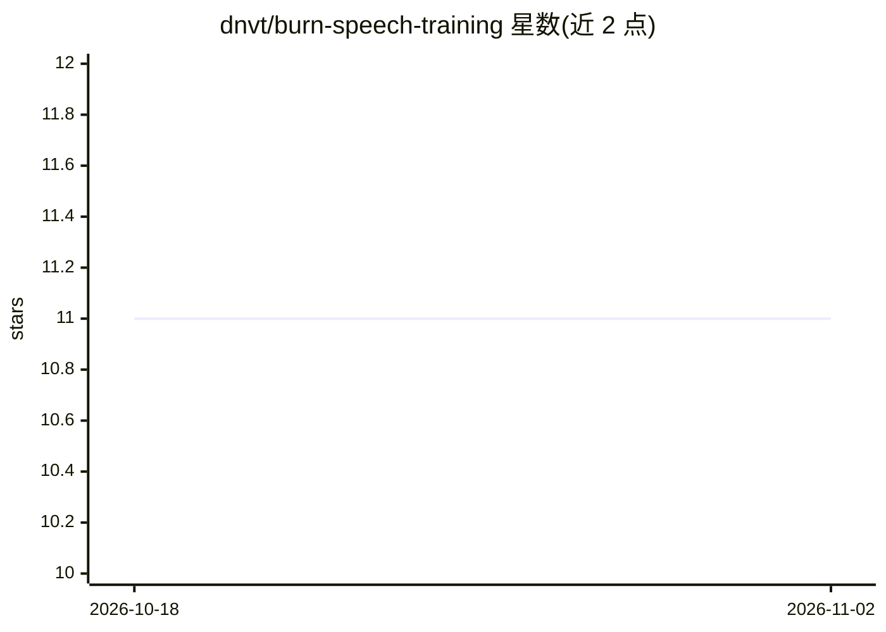

# dnvt/burn-speech-training

⭐ 11 · Rust · NOASSERTION · 推送 2026-10-11 · [GitHub](https://github.com/dnvt/burn-speech-training) · 个人维护

**Rust/Burn 上的语音训练管线：MFCC+CTC 与发音评分微调**

基于 Burn 深度学习框架的端到端语音训练管线，用 Rust 实现：MFCC/log-mel 特征提取、LibriSpeech 上的 CTC 对齐训练（SpeechAligner 模型默认 1.7M 参数）、SpeechOcean762 上的发音评分微调与 GOP 评测。既可作 CLI 工具（cargo install burn-speech-training）也可作库使用；支持 flex/wgpu/cuda 多后端。作者声明这是供阅读与改编的示例而非成熟框架，最佳发音评分为 ρ=0.292，GPU 后端仅在作者硬件上验证。

## 筛选速览

| 维度 | 判定 | 备注 |
|---|---|---|
| AI 角色 | `ai-native` | 本体是模型或模型工具 |
| 许可风险 | `none` | NOASSERTION |
| 部署形态 | `library` | 以包/库形式分发 |
| 模型依赖 | — | README 未给出锁定关系 |
| 硬件要求 | — | 无带数字的原话,不猜 |
| 安装摩擦 | `medium` | 含编译或系统依赖之一 |
| 成熟度 | `idea` | |

## 能力要点

- MFCC 特征 + CTC 训练 + SpeechOcean762 发音评分微调的完整管线
- CLI 与 Rust 库双形态，每个环节对应命令与库函数
- flex（纯 Rust CPU）/wgpu/cuda 多后端可编译
- 35 次微调实验记录与实验变体保留于 experiments feature

## 适用场景

- 在 Burn 框架下学习或改编语音 CTC 训练示例
- 构建基于 GOP 的发音评分（pronunciation scoring）原型
- 复现发音评分实验结果与消融分析

## 场景标签

`微调` `模型训练` · 领域:训练与推理

## 证据(README 行号)

> L8: A complete speech training pipeline in Rust on Burn:
> L9: MFCC features, CTC training on LibriSpeech, and fine-tuning for
> L10: pronunciation scoring on SpeechOcean762.

## 星数曲线

2026-10-18 11 → 2026-11-02 11（+0）

---
*卡片 v1 · prompt 1.4 · 生成 2026-11-02 · 置信度 high · 依据 README sha `ebb2f724988f` · [字段定义](../../DATASET.md)*
