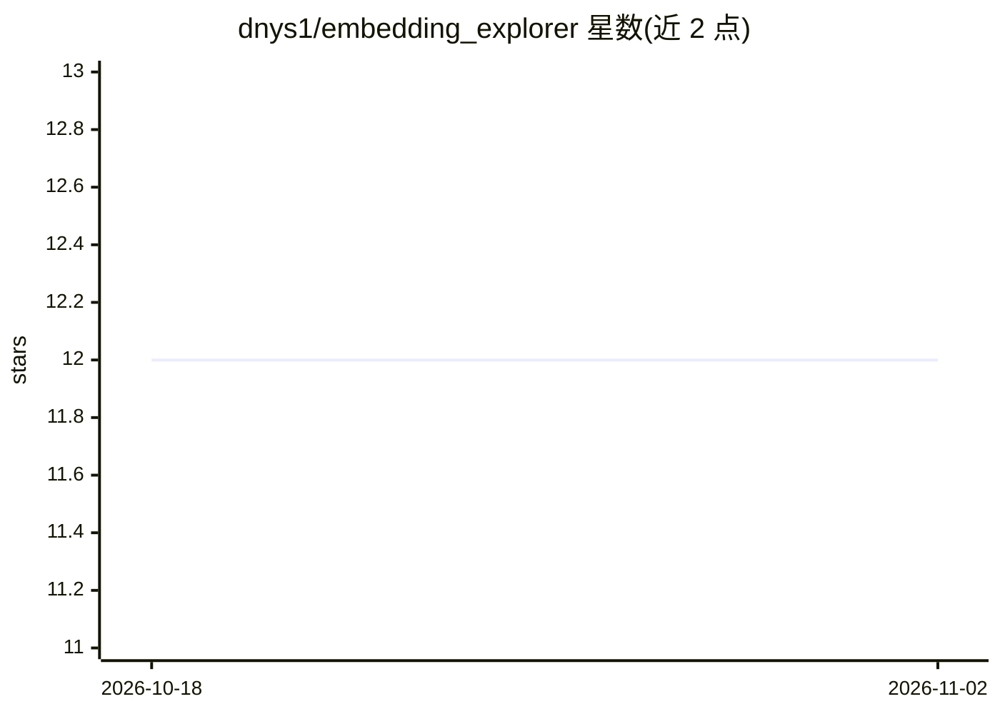

# dnys1/embedding_explorer

⭐ 12 · Dart · 推送 2025-11-24 · [GitHub](https://github.com/dnys1/embedding_explorer) · [官网](https://embeddings.thestartupapi.com) · 个人维护

**浏览器本地对比文本嵌入模型的实验 Web 应用**

完全在浏览器中运行的 Web 应用：连接 CSV、SQLite 或示例数据集，用模板定义数据预处理方式，配置多个嵌入 provider 与模型，批量生成嵌入向量并用 libSQL（WASM/OPFS）持久存储，随后运行 k-NN/余弦相似度查询，在各模型的结果列表间做并排对比。面向需要为具体用例挑选嵌入模型的开发者，提供 4 步工作流与任务进度跟踪。核心用 Dart/Jaspr 编写，开发需 Dart SDK 与 pnpm。

## 筛选速览

| 维度 | 判定 | 备注 |
|---|---|---|
| AI 角色 | `ai-ecosystem` | LLM/agent 周边工具 |
| 许可风险 | `none` | — |
| 部署形态 | `library` | 以包/库形式分发 |
| 模型依赖 | — | README 未给出锁定关系 |
| 硬件要求 | — | 无带数字的原话,不猜 |
| 安装摩擦 | `low` | 无编译、无系统依赖或容器化 |
| 成熟度 | — | 结构信号不足 |

## 能力要点

- 多模型嵌入生成与批量摄取/重嵌入任务（带进度跟踪）
- libSQL WASM + OPFS 实现浏览器内向量持久存储
- k-NN / 余弦相似度查询与逐模型结果并排对比视图
- 数据源接入：CSV 上传、SQLite 连接、示例数据集

## 适用场景

- 为我的检索/推荐场景并排对比多个嵌入模型的效果
- 用自己的数据快速生成嵌入并做相似度查询试验
- 避免在 notebook 里反复复制粘贴向量做临时脚本实验

## 场景标签

`语义搜索` `模型评测` · 领域:评测与运维

## 证据(README 行号)

> L3: Minimal web app for experimenting with and comparing text embedding models. It lets you ingest data, generate embedd
> L36: Execute embedding jobs across your chosen providers, monitor progress, and analyze results. Compare model performan

## 星数曲线

2026-10-18 12 → 2026-11-02 12（+0）

---
*卡片 v1 · prompt 1.4 · 生成 2026-11-01 · 置信度 mid · 依据 README sha `9cacbf6f4c0a` · [字段定义](../../DATASET.md)*
