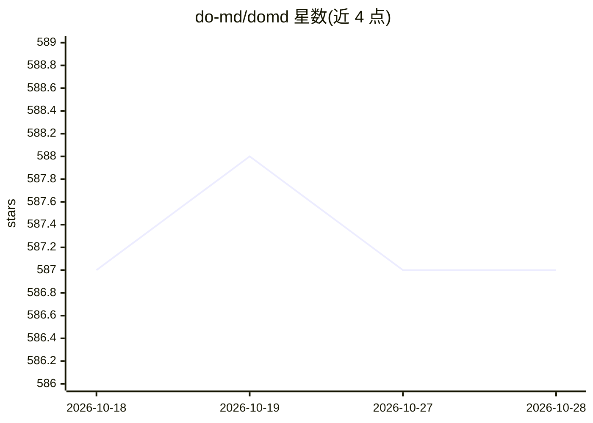

# do-md/domd

⭐ 586 · TypeScript · NOASSERTION · 推送 2026-09-23 · [GitHub](https://github.com/do-md/domd) · [官网](https://www.domd.app) · 个人维护 · 中文 README

**30KB Markdown 原生 WYSIWYG 编辑器内核与编辑器产品，支持 AI 流式输出**

包含两部分：可独立嵌入的编辑器内核 @do-md/core-react（React 组件，不基于 ProseMirror/Slate/Lexical，仅依赖 React 与 Immer，Brotli 压缩后 30+KB）与 DOMD 编辑器产品（macOS 原生应用、本地优先 Web 编辑器、agent 可用的 domd-cli）。面向需要在应用中嵌入 Markdown 编辑、输入或 AI 流式渲染的开发者，以及需要编辑大文件 Markdown 的用户。关键机制：流式分块渲染（处理语法中途被切断的 AI 输出）、段落内无冲突合并（基于操作流与可选 Yjs CRDT 插件）、可扩展行内语法（变体可绑定 React 组件）、分块文件加载支撑 2 万行文档。限制：Windows 原生构建不支持；内核 GPL-3.0 含例外条款（小型实体/FOSS 例外），超出例外需商业许可。

## 筛选速览

| 维度 | 判定 | 备注 |
|---|---|---|
| AI 角色 | `ai-enhanced` | 去掉 AI 部分产品仍成立 |
| 许可风险 | `none` | NOASSERTION |
| 部署形态 | `library` | 以包/库形式分发 |
| 模型依赖 | — | README 未给出锁定关系 |
| 硬件要求 | — | 无带数字的原话,不猜 |
| 安装摩擦 | `low` | 无编译、无系统依赖或容器化 |
| 成熟度 | — | 结构信号不足 |

## 能力要点

- 流式摄取 AI 分块输出，未闭合代码块/半成品表格可即时渲染且不闪烁
- 不基于通用富文本框架，自研 Markdown 原生引擎，仅 React 与 Immer 两个运行时依赖
- 段落内 CRDT 无冲突离线合并与多编辑器实时同步（远程光标 presence）
- 行内语法变体可绑定 React 组件，使 Markdown 片段成为交互 UI

## 适用场景

- 在聊天/笔记/产品中嵌入边输入边渲染的 Markdown 输入框
- 为 AI 应用提供能承接 token 流式输出的富文本渲染面
- 本地编辑大型 Markdown 文档（最高 2 万行流畅流式）
- 通过 domd-cli 让 agent 打开窗口、流入内容、改写选区

## 场景标签

 · 领域:编辑器/前端组件

## 证据(README 行号)

> L8: Built for fast human editing, huge Markdown files, live synchronization, and streaming AI output.
> L106: * **Agent-friendly CLI:** `domd-cli` can open windows, stream content into a document, and rewrite selections, mak

## 星数曲线

2026-10-18 587 → 2026-10-28 587（+0）

---
*卡片 v1 · prompt 1.4 · 生成 2026-10-21 · 置信度 high · 依据 README sha `b00d9eee2e96` · [字段定义](../../DATASET.md)*
