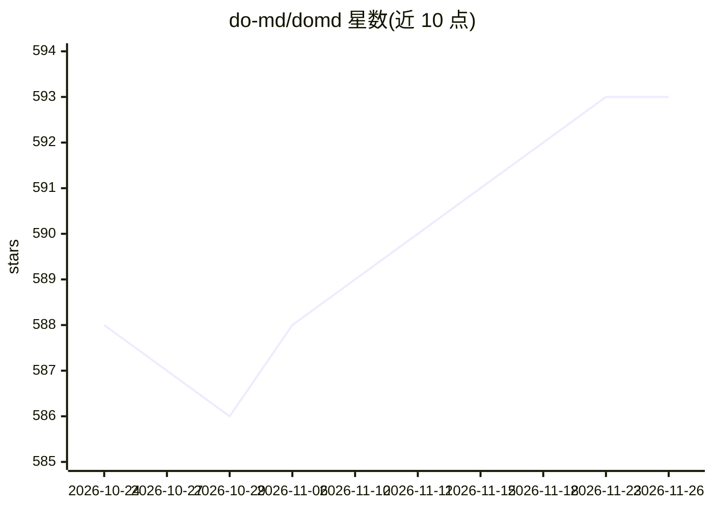

# do-md/domd

⭐ 593 · TypeScript · NOASSERTION · 推送 2026-11-07 · [GitHub](https://github.com/do-md/domd) · [官网](https://www.domd.app) · 组织维护 · 中文 README

**面向 AI 流式输出与大型文件的 Markdown 所见即所得编辑器**

DOMD 提供一个 30+ KB 的 Markdown 原生所见即所得编辑内核（@do-md/core-react），并将内核封装为本地优先的编辑器产品：覆盖 macOS 原生应用（含 Quick Look 预览）、Web 编辑器和面向 agent 的 CLI。内核支持逐块摄入 AI 流式 Markdown 输出并实时渲染、段落内无冲突离线合并（可选 Yjs CRDT 适配器）、多编辑器实时同步与远程光标、可扩展行内语法并绑定 React 组件。运行时依赖仅 React 与 Immer；Windows 原生构建目前不支持。

## 筛选速览

| 维度 | 判定 | 备注 |
|---|---|---|
| AI 角色 | `ai-enhanced` | 去掉 AI 部分产品仍成立 |
| 许可风险 | `none` | NOASSERTION |
| 部署形态 | `library` | 以包/库形式分发 |
| 模型依赖 | — | README 未给出锁定关系 |
| 硬件要求 | — | 无带数字的原话,不猜 |
| 安装摩擦 | `low` | 无编译、无系统依赖或容器化 |
| 成熟度 | — | 结构信号不足 |

## 能力要点

- 逐块摄入 AI 流式 Markdown，半开语法渲染中流保持正确
- 段落内无冲突离线合并，提供可选 Yjs CRDT 插件
- 行内语法为一等扩展点，可绑定 React 组件为活动 UI
- domd-cli 支持打开窗口、流式写入文档与改写选区

## 适用场景

- 为 AI 对话/生成界面提供渲染 Markdown 流的编辑区
- 在低配置设备上打开并编辑 1 MB 级 Markdown 文档
- 多设备离线编辑同一文档后合并且不丢改动
- 让 agent 通过 CLI 将输出写入本地文档窗口

## 场景标签

`AI 写作` · 领域:内容生成

## 证据(README 行号)

> L8: Built for fast human editing, huge Markdown files, live synchronization, and streaming AI output.
> L85: AI models emit Markdown token by token, often splitting in the middle of syntax. The kernel ingests those streams c
> L103: * **Large files:** a 5 KB note and a 1 MB document open at virtually the same perceptual speed, with full WYSIWYG 

## 星数曲线

2026-10-24 588 → 2026-11-26 593（+5）

---
*卡片 v1 · prompt 1.4 · 生成 2026-11-25 · 置信度 high · 依据 README sha `a4eebb866876` · [字段定义](../../DATASET.md)*
