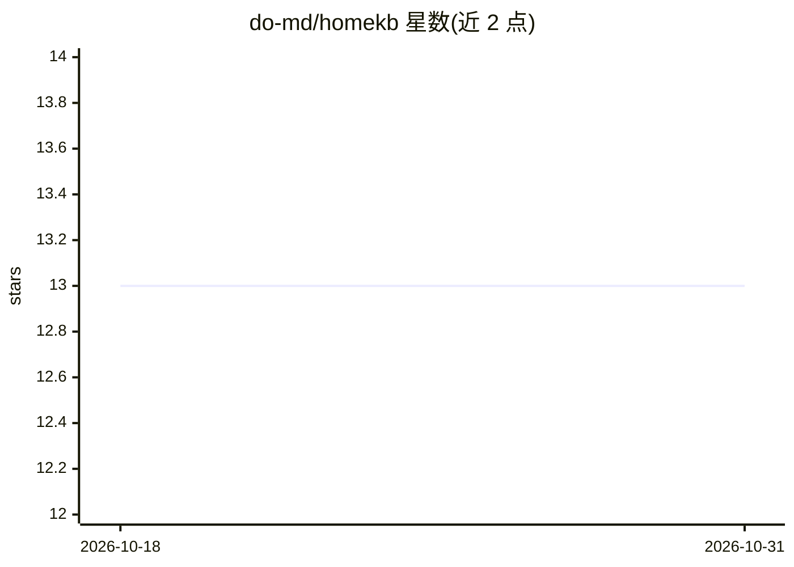

# do-md/homekb

⭐ 13 · TypeScript · MIT · 推送 2026-07-21 · [GitHub](https://github.com/do-md/homekb) · [官网](https://www.homekb.app) · 个人维护 · 中文 README

**本地优先的个人 Markdown 知识库：语义搜索、带引用问答与 MCP 接入**

HomeKB 把本地 Markdown 文件夹编译为 sqlite-vec 语义索引，提供含义搜索、带来源引用的问答、笔记增删改查与可撤销的公开分享链接。核心是自包含的 Rust CLI 引擎，桌面应用（Tauri）与 Web UI 复用同一 RPC 契约；远程访问经由可自托管的 Cloudflare Workers/Node 中继，中继不落盘存储知识库内容（非端到端加密）。通过本地 stdio MCP 或远程 MCP 端点向 Claude Code、Codex、ChatGPT 等 agent 暴露 kb_search/kb_read 等 7 个工具。嵌入/摘要模型可选 OpenAI、Gemini、DeepSeek、Qwen 等预设或自定义 OpenAI 兼容端点。后台服务管理目前仅 macOS 自动化。

## 筛选速览

| 维度 | 判定 | 备注 |
|---|---|---|
| AI 角色 | `ai-native` | 本体是模型或模型工具 |
| 许可风险 | `permissive` | MIT |
| 部署形态 | `library` | 以包/库形式分发 |
| 模型依赖 | — | README 未给出锁定关系 |
| 硬件要求 | — | 无带数字的原话,不猜 |
| 安装摩擦 | `low` | 无编译、无系统依赖或容器化 |
| 成熟度 | — | 结构信号不足 |

## 能力要点

- Markdown 目录增量编译为本地 sqlite-vec 语义索引，摘要与分块双池 KNN + RRF 融合检索
- 通过 MCP 向 Claude Code/Codex/Cursor/ChatGPT 暴露 kb_search、kb_read、kb_create 等 7 个工具
- 中继零数据落盘、配对码十分钟单次有效，支持自托管中继移除运营方信任路径
- 引擎为无运行时依赖的单二进制，homekb stop/uninstall 不删除知识库数据

## 适用场景

- 把现有 Markdown 笔记目录变成可语义搜索、可问答的私有知识库
- 让 Claude Code 或 ChatGPT 通过 MCP 直接读写我的本地笔记
- 手机或远程浏览器配对访问家中电脑上的知识库，无需公网 IP
- 为单篇笔记生成可撤销、可加密码与过期时间的公开链接

## 场景标签

`知识库管理` `语义搜索` `文档问答` · 领域:知识与检索

## 证据(README 行号)

> L17: Drop notes into `~/.homekb/notes/` — or point HomeKB at an existing Markdown folder — and the Rust engine increment
> L26: - Answer questions from local notes with source citations.

## 星数曲线

2026-10-18 13 → 2026-10-31 13（+0）

---
*卡片 v1 · prompt 1.4 · 生成 2026-10-31 · 置信度 mid · 依据 README sha `eaaf0ca92ef7` · [字段定义](../../DATASET.md)*
