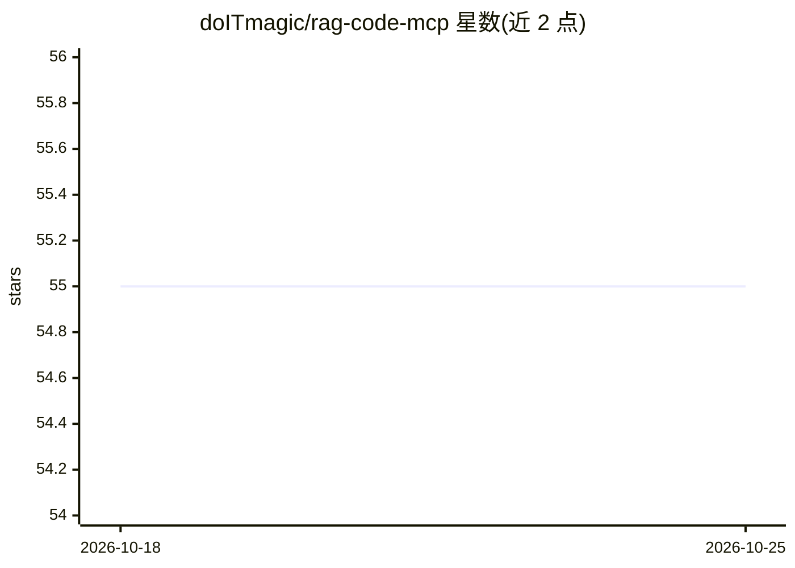

# doITmagic/rag-code-mcp

⭐ 55 · Go · MIT · 推送 2026-10-21 · [GitHub](https://github.com/doITmagic/rag-code-mcp) · [官网](https://doitmagic.github.io/rag-code-mcp/) · 组织维护

**本地优先的语义代码导航 MCP 服务器，让 AI IDE 理解整个代码库**

基于 Model Context Protocol Go SDK 构建的 MCP 服务器，将仓库索引为语义单元（函数、类等）并配合向量检索，向 GitHub Copilot、Cursor、Windsurf、Claude Desktop、Antigravity 等 AI IDE 提供 9 个代码检索工具（语义搜索、混合搜索、函数详情、类型定义、实现查找等）。支持 Go、PHP/Laravel、Python 的 AST 分析（JS/TS 规划中）。运行完全本地：Ollama 提供 LLM 与嵌入模型（phi3:medium、mxbai-embed-large），Qdrant 以 Docker 容器运行，无云端调用。通过 curl/PowerShell 一键安装器分发二进制并自动配置 IDE，最低要求 4 核 CPU、16 GB 内存、10 GB 磁盘与 Docker。由罗马尼亚公司 DO IT MAGIC SOFTWARE 维护，MIT 许可。

## 筛选速览

| 维度 | 判定 | 备注 |
|---|---|---|
| AI 角色 | `ai-ecosystem` | LLM/agent 周边工具 |
| 许可风险 | `permissive` | MIT |
| 部署形态 | `desktop` | 安装包/桌面程序 |
| 模型依赖 | local-ok | 支持本地模型 |
| 硬件要求 | — | 无带数字的原话,不猜 |
| 安装摩擦 | `low` | 无编译、无系统依赖或容器化 |
| 成熟度 | — | 结构信号不足 |

## 能力要点

- 9 个 MCP 工具：语义搜索、混合搜索、函数详情、类型定义、实现查找等
- 100% 本地运行：Ollama（LLM/嵌入）+ Docker 内 Qdrant，无云端依赖
- Go/PHP/Laravel/Python 的 AST 级语义分块与完整代码返回
- 一键安装器自动部署二进制、模型、容器并配置 IDE

## 适用场景

- 在 Cursor/Windsurf/Copilot 等 AI IDE 中用自然语言查询代码库
- 私有代码库需要本地语义检索、不能上云的团队
- 重构前查找函数实现与调用方

## 场景标签

`语义搜索` · 领域:知识与检索

## 证据(README 行号)

> L16: RagCode is a **Model Context Protocol (MCP) server** that instantly makes your project **AI-ready**. It enables AI 
> L18: Built with the official Model Context Protocol Go SDK, RagCode provides **9 powerful tools** to index, search, and 
> L145: ## 🛠️ 9 Powerful MCP Tools

## 星数曲线

2026-10-18 55 → 2026-10-25 55（+0）

---
*卡片 v1 · prompt 1.4 · 生成 2026-10-24 · 置信度 high · 依据 README sha `0ecdc3d29924` · [字段定义](../../DATASET.md)*
