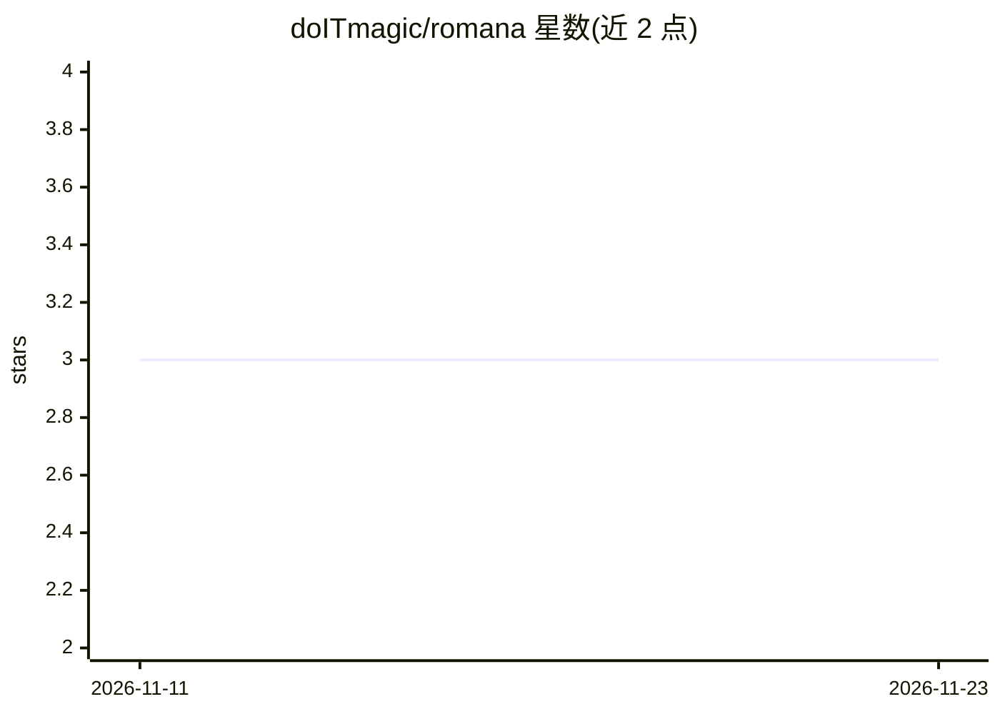

# doITmagic/romana

⭐ 3 · Go · MIT · 推送 2026-10-28 · [GitHub](https://github.com/doITmagic/romana) · [官网](https://doitmagic.ro/blog/romana-agenti-ai-scriu-corect-in-romana/) · 组织维护

**AI 代理的罗马尼亚语写作技能与本地词典工具（CLI/MCP）**

面向 AI 代理的罗马尼亚语工具包：以 Agent Skill 形式向代理提供 854 条按罗马尼亚学院规范制定的写作/校对/审阅规则，并基于 dexonline 官方导出数据构建本地词典，提供 CLI（romana cauta/verifica）与 MCP 服务器（查词、文本检查）两种形态；另有免安装的公共 MCP 服务器，带速率与配额限制。Go 编写的单个预编译二进制，首次使用需下载约 360 MB 词典导出并建库。以 MIT 许可发布。

## 筛选速览

| 维度 | 判定 | 备注 |
|---|---|---|
| AI 角色 | `ai-native` | 本体是模型或模型工具 |
| 许可风险 | `permissive` | MIT |
| 部署形态 | `desktop` | 安装包/桌面程序 |
| 模型依赖 | locked-api |  |
| 硬件要求 | — | 无带数字的原话,不猜 |
| 安装摩擦 | `low` | 无编译、无系统依赖或容器化 |
| 成熟度 | — | 结构信号不足 |

## 能力要点

- 854 条罗马尼亚语规范规则，含明确列出的『非错误』清单
- 基于 dexonline 官方导出构建约 300 MB 本地 SQLite 词典
- 五种使用形态：插件、纯技能、本地 MCP 服务器、公共 MCP 服务器、CLI
- 公共 MCP 服务器设速率与每日配额限制，不存储检查文本

## 适用场景

- 让 Claude Code/Codex 等代理写出符合规范的罗马尼亚语文本
- 在 CI 或脚本中用 CLI 批量检查罗马尼亚语文本
- 在 ChatGPT/claude.ai 中接入公共 MCP 服务器做词典与错误检查
- 在 PR 中自动检查代理写的罗马尼亚语文本

## 场景标签

`AI 写作` · 领域:内容生成

## 证据(README 行号)

> L1: romana: a Romanian writing skill for AI agents and a local Romanian dictionary tool (CLI and MCP server) built on de
> L14: Language models write Romanian that is grammatical but often sounds translated: English calques („a face sens”), fa
> L22: |**MCP server only**|dictionary lookups (`cauta_cuvant`) and text checks (`verifica_text`), without the rules|any M

## 星数曲线

2026-11-11 3 → 2026-11-23 3（+0）

---
*卡片 v1 · prompt 1.4 · 生成 2026-11-22 · 置信度 mid · 依据 README sha `12e9e8879567` · [字段定义](../../DATASET.md)*
