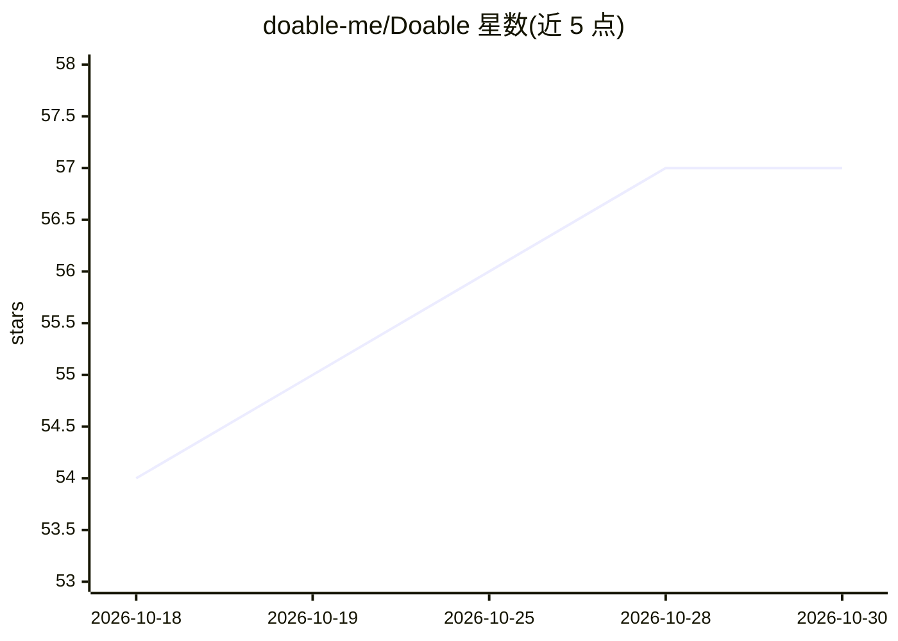

# doable-me/Doable

⭐ 57 · TypeScript · MIT · 推送 2026-07-21 · [GitHub](https://github.com/doable-me/Doable) · [官网](https://doable.me) · 组织维护

**面向团队的自托管多租户 AI 应用构建平台**

MIT 许可的自托管 AI 应用构建器：用户用自然语言描述需求，平台生成含前端、进程内后端与 PGlite 数据库的完整应用，提供实时预览、Monaco 代码编辑器与 ZIP/GitHub 导出。面向需要数据自有的团队：多租户工作区（行级安全隔离）、RBAC、TOTP MFA、审计日志、按项目的沙箱化代码执行（Linux UID/seccomp/出口防火墙）。支持 53+ AI 供应商 BYOK（含 Ollama/vLLM 本地模型与气隙部署），内置多个 MCP 服务器（PDF/演示文稿/表格/数据库），可一键部署至主流 PaaS。Docker 为主要安装路径。

## 筛选速览

| 维度 | 判定 | 备注 |
|---|---|---|
| AI 角色 | `ai-native` | 本体是模型或模型工具 |
| 许可风险 | `permissive` | MIT |
| 部署形态 | `library` | 以包/库形式分发 |
| 模型依赖 | local-ok | 支持本地模型 |
| 硬件要求 | — | 无带数字的原话,不猜 |
| 安装摩擦 | `low` | 无编译、无系统依赖或容器化 |
| 成熟度 | — | 结构信号不足 |

## 能力要点

- 自然语言生成含进程内后端（RLS）与数据库的完整应用，实时预览
- 多租户工作区：行级安全隔离、RBAC、MFA、审计日志、配额分层
- 沙箱化代码执行：per-project Linux UID、seccomp、出口防火墙，默认开启
- BYOK 支持 53+ AI 供应商，含 Ollama/LM Studio/vLLM 的气隙部署
- 内置 PDF/演示文稿/表格/Markdown/数据库等 MCP 服务器

## 适用场景

- 在自有服务器上为团队或客户提供隔离的 AI 应用构建工作区
- 受监管行业在数据不出境的前提下使用 AI 构建内部应用
- 用自然语言快速生成带聊天机器人和数据库的 Web 应用并导出源码

## 场景标签

`代码生成` · 领域:编码与开发

## 证据(README 行号)

> L8:  Describe what you want. Doable builds it, deploys it, and hosts it on hardware you control.
> L66:  AI chat & build — describe what you want and Doable generates a fully working app — frontend, in-process backend, 
> L144: |**Air-gapped deployment**|Run with local models, no internet egress, services bound to `127.0.0.1`. Point at Olla

## 星数曲线

2026-10-18 54 → 2026-10-30 57（+3）

---
*卡片 v1 · prompt 1.4 · 生成 2026-10-24 · 置信度 mid · 依据 README sha `47d3f450d5c5` · [字段定义](../../DATASET.md)*
