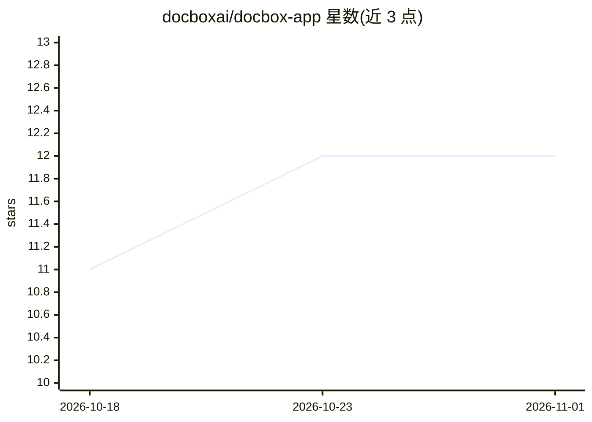

# docboxai/docbox-app

⭐ 12 · Python · Apache-2.0 · 推送 2026-10-21 · [GitHub](https://github.com/docboxai/docbox-app) · [官网](https://docbox-iota.vercel.app/) · 组织维护

**本地离线 OCR 桌面应用：读取图片和 PDF 中的文字**

面向 Windows、macOS（Apple Silicon）与 Linux 的桌面应用，本地运行开源 OCR 模型读取图片与 PDF 文字，输出纯文本、Markdown、可搜索 PDF 或 JSON。支持 PaddleOCR、PaddleOCR-VL、Tesseract、EasyOCR、Ollama 视觉模型与可选的 NVIDIA NIM 云引擎；检测本机内存/磁盘并提示可运行的模型，一键安装引擎与模型文件。内置用自有文档对比各模型准确率与速度的基准测试功能。无账户、无遥测，文档默认不离开本机。开发栈为 Tauri 2 + React + 本地 FastAPI 后端。限制：不支持 Intel Mac，EasyOCR 需 macOS 14+，安装包未签名/公证。

## 筛选速览

| 维度 | 判定 | 备注 |
|---|---|---|
| AI 角色 | `ai-native` | 本体是模型或模型工具 |
| 许可风险 | `permissive` | Apache-2.0 |
| 部署形态 | `desktop` | 安装包/桌面程序 |
| 模型依赖 | local-ok | 支持本地模型 |
| 硬件要求 | — | 无带数字的原话,不猜 |
| 安装摩擦 | `low` | 无编译、无系统依赖或容器化 |
| 成熟度 | — | 结构信号不足 |

## 能力要点

- 一键安装 OCR 引擎与模型，检测本机硬件判断可运行模型
- 多引擎支持：PaddleOCR / PaddleOCR-VL / Tesseract / EasyOCR / Ollama / NVIDIA NIM
- 用自有文档做基准测试：准确率×成本排行榜与逐模型对比
- 无账户、无遥测、本地运行，仅云引擎开启时上传图片

## 适用场景

- 离线识别扫描件、收据、截图中的文字并导出可搜索 PDF
- 在一台电脑上对比多个 OCR 模型找最适合自己文档的一个
- 不想配置 Python 环境即可本地运行开源 OCR 模型

## 场景标签

`OCR` · 领域:感知与多模态

## 证据(README 行号)

> L5:  Read text from images and PDFs, on your own computer.
> L14: open-source OCR (optical character recognition) models locally. It checks your computer's
> L71: Go to **Read a file** and drop images or PDFs onto the box, click **Choose files**, or

## 星数曲线

2026-10-18 11 → 2026-11-01 12（+1）

---
*卡片 v1 · prompt 1.4 · 生成 2026-11-01 · 置信度 mid · 依据 README sha `e7aebd7aa5fb` · [字段定义](../../DATASET.md)*
