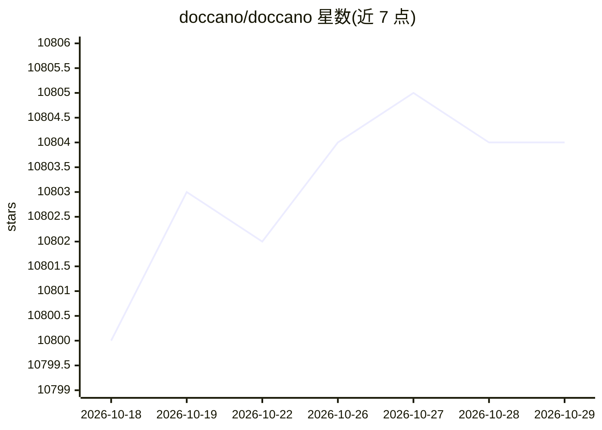

# doccano/doccano

⭐ 10,804 · Python · MIT · 推送 2026-04-14 · [GitHub](https://github.com/doccano/doccano) · 组织维护

**给机器学习从业者的开源文本标注工具：制作训练数据集**

面向机器学习从业者的开源文本标注工具，覆盖文本分类、序列标注、序列到序列任务，用于制作情感分析、命名实体识别、文本摘要等标注数据集。使用流程为创建项目、上传数据、开始标注，支持多人协作、多语言、移动端与 RESTful API。提供三种运行方式：pip 安装（Python 3.8+，默认 SQLite，可选 PostgreSQL）、Docker 与 Docker Compose，另有 AWS/Heroku 一键部署。pip 方式需分别启动 webserver 与任务队列进程。

## 筛选速览

| 维度 | 判定 | 备注 |
|---|---|---|
| AI 角色 | `ai-ecosystem` | LLM/agent 周边工具 |
| 许可风险 | `permissive` | MIT |
| 部署形态 | `self-host` | docker 或自建部署 |
| 模型依赖 | — | README 未给出锁定关系 |
| 硬件要求 | — | 无带数字的原话,不猜 |
| 安装摩擦 | `low` | 无编译、无系统依赖或容器化 |
| 成熟度 | — | 结构信号不足 |

## 能力要点

- 支持文本分类、序列标注、序列到序列三类标注任务
- 协作标注、多语言、移动端、RESTful API
- pip / Docker / Docker Compose / AWS / Heroku 多种部署途径
- 默认 SQLite，可选 PostgreSQL 存储

## 适用场景

- 为情感分析、命名实体识别任务制作标注数据集
- 团队协作完成文本数据标注并导出数据集
- 通过 RESTful API 将标注流程集成到数据处理管线

## 场景标签

`MLOps` · 领域:训练与推理

## 证据(README 行号)

> L6: doccano is an open-source text annotation tool for humans. It provides annotation features for text classification, 
> L40: pip install doccano

## 星数曲线

2026-10-18 10,800 → 2026-10-29 10,804（+4）

---
*卡片 v1 · prompt 1.4 · 生成 2026-10-20 · 置信度 high · 依据 README sha `b8824505aae2` · [字段定义](../../DATASET.md)*
