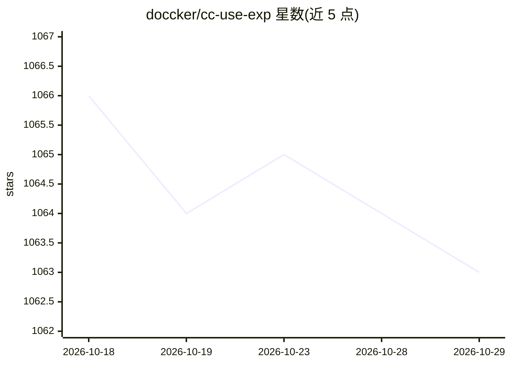

# doccker/cc-use-exp

⭐ 1,063 · Python · NOASSERTION · 推送 2026-08-26 · [GitHub](https://github.com/doccker/cc-use-exp) · [官网](https://github.com/dev-agent-kit/recipes.git) · 个人维护 · 中文 README

**六款 AI 编码 CLI/IDE 的开箱即用分层配置模板体系**

为 Claude Code、Antigravity CLI、Gemini CLI、Codex、Cursor、GitHub Copilot 提供统一维护的 rules、skills、workflow 配置模板：一次维护，通过 Plugin Marketplace、会话内命令或 Shell 脚本同步到各工具用户级目录。配置分层加载（rules 常驻 + skills 按需 + commands 显式调用），内置防御性规则与多种语言/安全技能，支持 skill 单向跨平台同步。README 声明本仓库已停止更新，新能力迁移至 dev-agent-kit/recipes，以付费小群（¥699）方式提供。

## 筛选速览

| 维度 | 判定 | 备注 |
|---|---|---|
| AI 角色 | `ai-ecosystem` | LLM/agent 周边工具 |
| 许可风险 | `none` | NOASSERTION |
| 部署形态 | `None` |  |
| 模型依赖 | — | README 未给出锁定关系 |
| 硬件要求 | — | 无带数字的原话,不猜 |
| 安装摩擦 | `low` | 无编译、无系统依赖或容器化 |
| 成熟度 | — | 结构信号不足 |

## 能力要点

- 一次维护，六套 AI 工具（Claude Code/Antigravity/Gemini CLI/Codex/Cursor/Copilot）分别同步
- 分层加载：rules 常驻 + skills 按需 + commands 显式触发
- 内置防御性规则（危险命令确认、测试篡改防护）与多语言/安全 skills
- skill 单向同步脚本，Claude 为权威源分发到其他平台

## 适用场景

- 同时在多个 AI 编码工具间复用统一的编码规范和协作约定
- 把团队协作方式沉淀为可维护的 rules、skills 和 workflow
- 降低 AI 常见错误操作与危险命令风险

## 场景标签

`提示工程` · 领域:Agent 开发

## 证据(README 行号)

> L5: > 保留你熟悉的 CLI/IDE，让 Claude Code、Gemini CLI、Codex、Cursor、GitHub Copilot 开箱即用
> L50: - 一次维护，六套工具分别同步到各自用户级入口
> L247: |Claude Code|`.claude/`|`~/.claude/`|会话内或 Plugin|✅ 完整支持|

## 星数曲线

2026-10-18 1,066 → 2026-10-29 1,063（-3）

---
*卡片 v1 · prompt 1.4 · 生成 2026-10-21 · 置信度 high · 依据 README sha `0b75de7aa7e8` · [字段定义](../../DATASET.md)*
