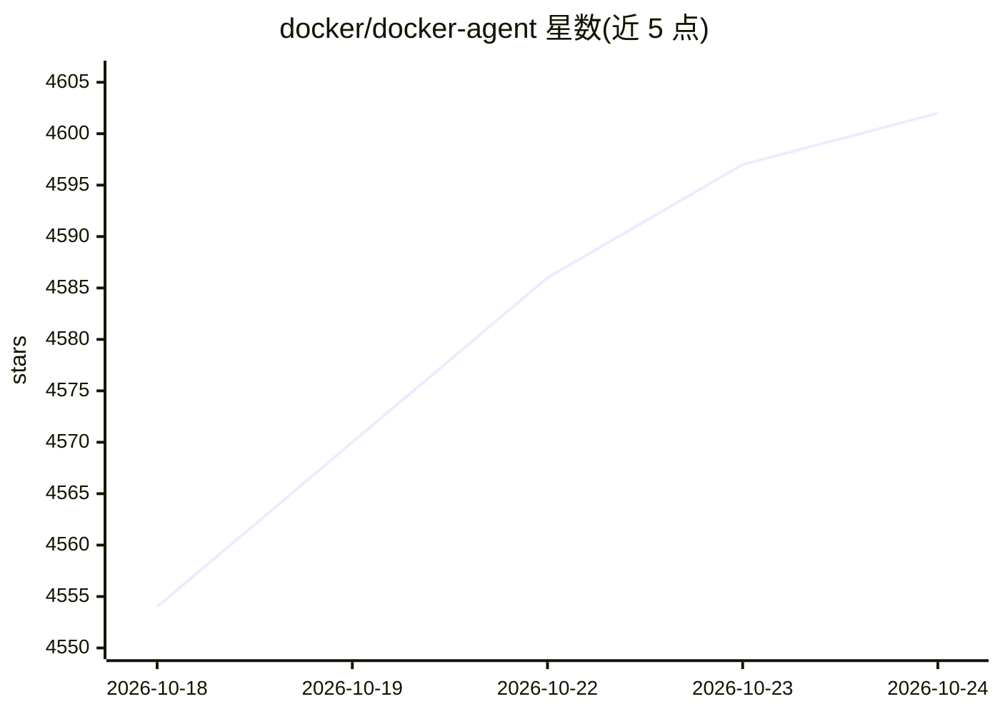

# docker/docker-agent

⭐ 4,602 · Go · Apache-2.0 · 推送 2026-10-23 · [GitHub](https://github.com/docker/docker-agent) · [官网](https://docker.github.io/docker-agent/) · 组织维护

**Docker 官方的 YAML 声明式 AI Agent 构建与运行时**

Docker Engineering 开发的 docker CLI 插件（Docker Desktop 4.63+ 预装）：以声明式 YAML 定义多 agent 团队并运行，无需写代码。支持 OpenAI、Anthropic、Gemini、AWS Bedrock、Mistral、xAI 及 Docker Model Runner 等模型来源；工具生态内置 think/todo/memory 工具并可接入任意 MCP server；RAG 支持 BM25、向量、混合检索与重排序；agent 可打包推送到 OCI registry 分享。安装途径含 Docker Desktop 预装、Homebrew 与 GitHub Releases 二进制。

## 筛选速览

| 维度 | 判定 | 备注 |
|---|---|---|
| AI 角色 | `ai-ecosystem` | LLM/agent 周边工具 |
| 许可风险 | `permissive` | Apache-2.0 |
| 部署形态 | `None` |  |
| 模型依赖 | — | README 未给出锁定关系 |
| 硬件要求 | — | 无带数字的原话,不猜 |
| 安装摩擦 | `low` | 无编译、无系统依赖或容器化 |
| 成熟度 | — | 结构信号不足 |

## 能力要点

- YAML 声明式定义多 agent 团队，任务自动委派
- 内置工具 + 任意 MCP server（本地/远程/Docker）
- 多模型提供商支持，含 Docker Model Runner 本地模型
- agent 可推送到 OCI registry 供他人拉取运行

## 适用场景

- 用 YAML 快速搭建并运行多 agent 协作系统
- 为 agent 接入 MCP 工具与可插拔 RAG
- 把做好的 agent 打包发布到 OCI registry 分享

## 场景标签

`Agent 框架` `多智能体` · 领域:Agent 开发

## 证据(README 行号)

> L9: `docker-agent` lets you create and run intelligent AI agents that collaborate to solve complex problems — no code re
> L11: `docker-agent` is a `docker` CLI plugin and can be run with `docker agent`.

## 星数曲线

2026-10-18 4,554 → 2026-10-24 4,602（+48）

---
*卡片 v1 · prompt 1.4 · 生成 2026-10-20 · 置信度 high · 依据 README sha `b7d944c98afb` · [字段定义](../../DATASET.md)*
