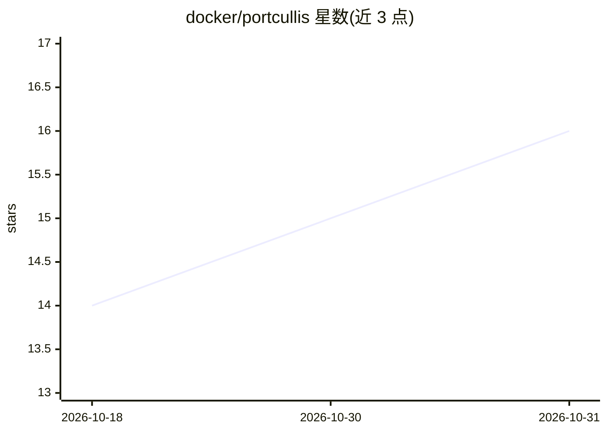

# docker/portcullis

⭐ 16 · Go · Apache-2.0 · 推送 2026-10-21 · [GitHub](https://github.com/docker/portcullis) · 组织维护

**检测并脱敏文本中 API 令牌与云凭据的 Go 库**

无第三方依赖的 Go 库，提供 Contains（检测）与 Redact（替换为 [REDACTED]）两个并发安全的公开函数，用于 LLM agent、日志管道、错误上报等场景在文本流出前清除凭据。内置约 240 条规则，覆盖云厂商、代码托管与 CI、AI 提供商、支付、通信、SaaS、基础设施与 PII。实现上先以单次 Aho–Corasick 扫描产出关键词位集，多数干净输入不触发正则；脱敏操作幂等。规则集派生自 docker/mcp-gateway 与 trivy 的 MIT 许可代码。

## 筛选速览

| 维度 | 判定 | 备注 |
|---|---|---|
| AI 角色 | `ai-ecosystem` | LLM/agent 周边工具 |
| 许可风险 | `permissive` | Apache-2.0 |
| 部署形态 | `library` | 以包/库形式分发 |
| 模型依赖 | — | README 未给出锁定关系 |
| 硬件要求 | — | 无带数字的原话,不猜 |
| 安装摩擦 | `low` | 无编译、无系统依赖或容器化 |
| 成熟度 | — | 结构信号不足 |

## 能力要点

- 仅 Contains/Redact 两个函数的公开 API，并发安全
- 约 240 条内置规则，覆盖云凭据、AI 提供商密钥、支付卡、IBAN、SSN 等
- Aho–Corasick 预扫描 + 位集短路，干净输入零分配、不触发正则
- 默认 [REDACTED] 标记不匹配任何内置规则，多次脱敏幂等

## 适用场景

- LLM agent 输出与日志上报前清除凭据
- 多阶段管道中对文本做幂等脱敏
- 快速判断文本是否包含密钥（Contains）

## 场景标签

`网络安全` · 领域:学习与行业

## 证据(README 行号)

> L17: LLM agents, log pipelines, error reporters, and anything else that
> L21: `docker-agent`, built around
> L65: - LLM / AI providers — OpenAI, Anthropic, DeepSeek, Google (AIza),

## 星数曲线

2026-10-18 14 → 2026-10-31 16（+2）

---
*卡片 v1 · prompt 1.4 · 生成 2026-10-30 · 置信度 high · 依据 README sha `4e4afbc9deaf` · [字段定义](../../DATASET.md)*
