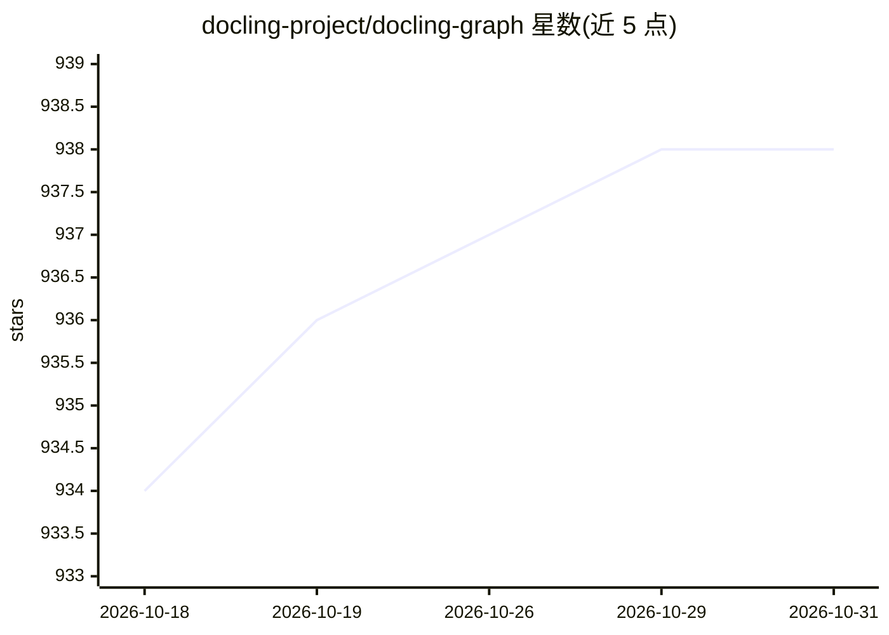

# docling-project/docling-graph

⭐ 938 · Python · MIT · 推送 2026-10-26 · [GitHub](https://github.com/docling-project/docling-graph) · 组织维护

**把非结构化文档转成可查询知识图谱的抽取工具链**

IBM 维护的 Docling 生态工具：将 PDF、Office、markdown 等文档转换为经校验的 Pydantic 对象，再构建带语义关系的有向知识图（NetworkX），节点附确定性溯源属性。抽取支持本地 VLM（经 Docling）与经 LiteLLM 路由的 LLM 后端（vLLM/Ollama 本地运行时及 OpenAI/Gemini/watsonx 等 API）。面向化学、金融、法律等需精确实体连接的领域，提供 Pydantic 模板生成（含从样例文档、OWL/RDFS 本体生成）、图融合、CSV/Cypher 导出与 HTML 可视化，以 Python 包与 CLI 提供。

## 筛选速览

| 维度 | 判定 | 备注 |
|---|---|---|
| AI 角色 | `ai-ecosystem` | LLM/agent 周边工具 |
| 许可风险 | `permissive` | MIT |
| 部署形态 | `library` | 以包/库形式分发 |
| 模型依赖 | local-ok | 支持本地模型 |
| 硬件要求 | — | 无带数字的原话,不猜 |
| 安装摩擦 | `low` | 无编译、无系统依赖或容器化 |
| 成熟度 | — | 结构信号不足 |

## 能力要点

- 文档→Pydantic 校验对象→NetworkX 有向知识图，节点带确定性溯源属性
- 双抽取路径：Docling 本地 VLM 与 LiteLLM 路由的 LLM（本地 vLLM/Ollama 与多家 API）
- Pydantic 模板可从样例文档或 OWL/RDFS/SKOS/LinkML 本体生成，规则书 lint 校验
- 图融合、确定性溯源账本、CSV/Cypher 导出与 HTML 可视化

## 适用场景

- 把化学/金融/法律文档抽取为精确实体关系知识图
- 从多份样例文档自动归纳抽取模板再批量处理
- 将抽取结果导出 Cypher 接入图数据库或生成可视化报告

## 场景标签

`知识图谱` `文档解析` · 领域:知识与检索

## 证据(README 行号)

> L23: Docling-Graph turns documents into validated **Pydantic** objects, then builds a **directed knowledge graph** with 
> L27: This toolkit supports two extraction paths: **local VLM extraction** via Docling, and **LLM-based extraction** rout

## 星数曲线

2026-10-18 934 → 2026-10-31 938（+4）

---
*卡片 v1 · prompt 1.4 · 生成 2026-10-21 · 置信度 high · 依据 README sha `3ff5d4e080d4` · [字段定义](../../DATASET.md)*
