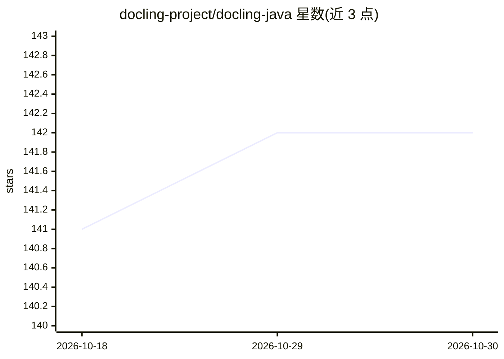

# docling-project/docling-java

⭐ 142 · Java · MIT · 推送 2026-10-28 · [GitHub](https://github.com/docling-project/docling-java) · [官网](https://docling-project.github.io/docling-java/) · 组织维护

**Docling 文档转换能力的 Java API 与客户端库**

为 Docling 文档处理项目提供 Java 接入：docling-core 提供 DoclingDocument 数据类型的 Java API，docling-serve-api 定义与 Docling Serve 后端交互的框架无关接口，docling-serve-client 基于 HttpClient 与 Jackson 给出参考实现，另含测试工具与 Testcontainers 模块（在 Docker 容器中运行 Docling）。文档转换本身由 Docling 后端执行，支持 PDF/DOCX/音频/图片等多格式解析与 Markdown/HTML/JSON 等导出，并提供 LangChain4j 集成。面向在 JVM 生态中接入 Docling 的开发者。

## 筛选速览

| 维度 | 判定 | 备注 |
|---|---|---|
| AI 角色 | `ai-ecosystem` | LLM/agent 周边工具 |
| 许可风险 | `permissive` | MIT |
| 部署形态 | `None` |  |
| 模型依赖 | — | README 未给出锁定关系 |
| 硬件要求 | — | 无带数字的原话,不猜 |
| 安装摩擦 | `low` | 无编译、无系统依赖或容器化 |
| 成熟度 | — | 结构信号不足 |

## 能力要点

- 四个 Maven 工件：core 数据类型 API、serve-api 接口、serve-client 参考实现、testcontainers 模块
- 通过 DoclingServeApi.convertSource() 转换单个文档
- 支持与 LangChain4j 即插即用集成
- Testcontainers 模块可在 Docker 容器中运行 Docling

## 适用场景

- 在 Java 应用中调用 Docling Serve 做文档转换
- 为 RAG 流水线准备 Markdown/HTML/JSON 格式文档
- 用 Testcontainers 在集成测试中运行 Docling

## 场景标签

`文档解析` · 领域:知识与检索

## 证据(README 行号)

> L5: This is the repository for Docling Java, a Java API for using Docling.
> L42: - `docling-serve-api`: Java API for interacting with a Docling Serve backend. It's framework‑agnostic.
> L43: * `docling-serve-client`: A reference implementation of the `docling-serve-api` using Java's `HttpClient` and Jacks

## 星数曲线

2026-10-18 141 → 2026-10-30 142（+1）

---
*卡片 v1 · prompt 1.4 · 生成 2026-10-22 · 置信度 high · 依据 README sha `9c867f73cb1d` · [字段定义](../../DATASET.md)*
