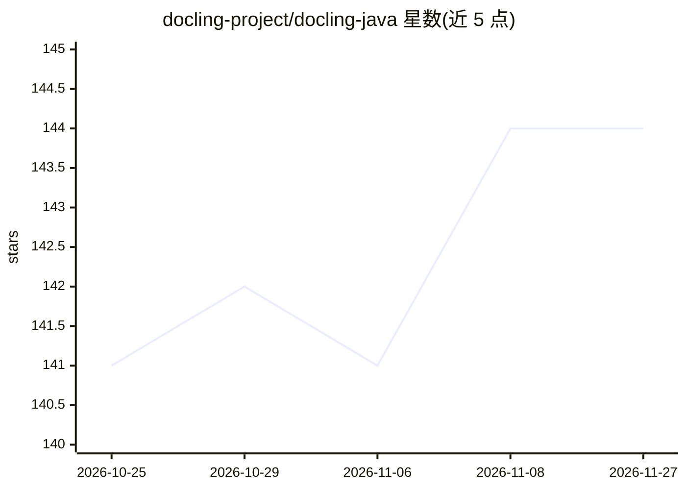

# docling-project/docling-java

⭐ 144 · Java · MIT · 推送 2026-11-25 · [GitHub](https://github.com/docling-project/docling-java) · [官网](https://docling-project.github.io/docling-java/) · 组织维护

**给 Java 开发者的 Docling 文档处理 API**

Docling Java 提供 Java 语言的 API，用于使用 Docling 进行文档解析与转换：支持 PDF、DOCX、PPTX、XLSX、HTML、音视频与图片等多种格式的解析，包含 PDF 版面/表格/公式理解、OCR、ASR 及视觉语言模型支持，输出 Markdown、HTML、DocTags、JSON 等格式。项目由多个 Maven 构件组成，核心 API 面向 Docling Serve 后端交互，另提供 Testcontainers 模块以 Docker 容器方式运行 Docling。由 IBM Research Zurich 的 AI for knowledge 团队发起，MIT 许可。README 未给出完整安装命令，仅指向 Maven 构件与文档。

## 筛选速览

| 维度 | 判定 | 备注 |
|---|---|---|
| AI 角色 | `ai-ecosystem` | LLM/agent 周边工具 |
| 许可风险 | `permissive` | MIT |
| 部署形态 | `None` |  |
| 模型依赖 | — | README 未给出锁定关系 |
| 硬件要求 | — | 无带数字的原话,不猜 |
| 安装摩擦 | `low` | 无编译、无系统依赖或容器化 |
| 成熟度 | — | 结构信号不足 |

## 能力要点

- 多格式文档解析：PDF/DOCX/PPTX/XLSX/HTML/音频/图片
- 高级 PDF 理解（版面、表格、公式）与 OCR 支持
- docling-serve-client 通过 HttpClient 连接 Docling Serve 端点
- docling-testcontainers 支持以 Docker 容器运行 Docling

## 适用场景

- 在 Java 应用中把各类文档转换为 Markdown/JSON 供下游使用
- 为 RAG 流水线准备文档解析与结构化输出
- 用 Testcontainers 在测试中以容器方式运行 Docling

## 场景标签

`文档解析` `RAG` · 领域:知识与检索

## 证据(README 行号)

> L5: This is the repository for Docling Java, a Java API for using Docling.
> L42: - `docling-serve-api`: Java API for interacting with a Docling Serve backend. It's framework‑agnostic.
> L80: The project was started by the AI for knowledge team at IBM Research Zurich.

## 星数曲线

2026-10-25 141 → 2026-11-27 144（+3）

---
*卡片 v1 · prompt 1.4 · 生成 2026-11-27 · 置信度 high · 依据 README sha `d5f2b182f9e5` · [字段定义](../../DATASET.md)*
