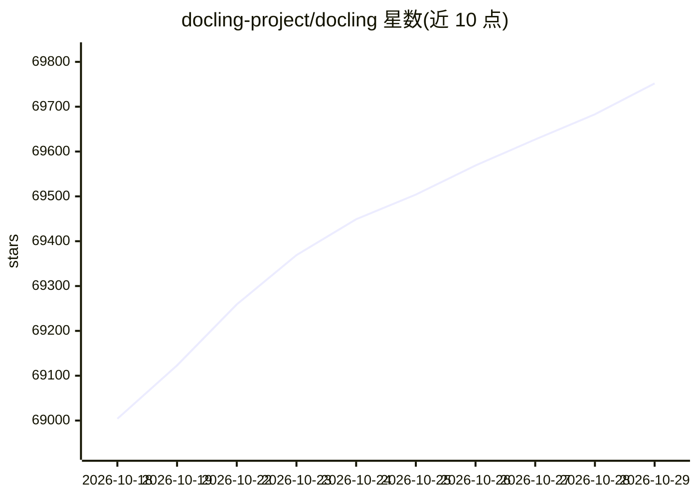

# docling-project/docling

⭐ 69,752 · Python · MIT · 推送 2026-10-28 · [GitHub](https://github.com/docling-project/docling) · [官网](https://docling-project.github.io/docling) · 组织维护

**文档解析转换库：为生成式 AI 准备各格式文档**

解析 PDF、Office 文档、HTML、音频、图像等多种格式，输出统一的 DoclingDocument 表示，可导出 Markdown、HTML、JSON 等；含版面/阅读顺序/表格结构理解、OCR、ASR、VLM 流水线。提供 Python API、CLI、docling-serve API 服务与 MCP server。本地可运行，适合敏感数据与离线环境。需 Python 3.10+，由 IBM 研究团队发起、LF AI & Data 基金会托管。

## 筛选速览

| 维度 | 判定 | 备注 |
|---|---|---|
| AI 角色 | `ai-ecosystem` | LLM/agent 周边工具 |
| 许可风险 | `permissive` | MIT |
| 部署形态 | `library` | 以包/库形式分发 |
| 模型依赖 | — | README 未给出锁定关系 |
| 硬件要求 | — | 无带数字的原话,不猜 |
| 安装摩擦 | `low` | 无编译、无系统依赖或容器化 |
| 成熟度 | — | 结构信号不足 |

## 动量与使用信号

- 维护:`active` — 距上次 push 1.7 天,年发版 97,370 位贡献者
- 涨星:近 1 天 **+39**(自 20261016 起算)
- 安装:pypi 包 `docling` 月下载 2,909,751
- 平台:WINDOWS / MACOS / LINUX · 协议:MCP

## 能力要点

- 多格式解析：PDF、DOCX、PPTX、HTML、音频、图像等
- 高级 PDF 理解：版面、阅读顺序、表格结构、公式
- 与 LangChain、LlamaIndex、Crew AI、Haystack 的集成及 MCP server
- 支持本地执行，可用于气隙环境

## 适用场景

- 把 PDF/Office 文档转成 Markdown/JSON 喂给 LLM 应用
- 扫描件 OCR 与表格结构抽取
- 为 agent/RAG 流水线提供文档解析后端
- 内网离线环境处理敏感文档

## 场景标签

`文档解析` `OCR` · 领域:知识与检索

## 证据(README 行号)

> L27: Docling simplifies document processing by parsing diverse formats — including advanced PDF understanding — and prov
> L37: - 🤖 Plug-and-play [integrations][integrations] incl. LangChain, LlamaIndex, Crew AI & Haystack for agentic AI

## 星数曲线

2026-10-18 69,004 → 2026-10-29 69,752（+748）

---
*卡片 v1 · prompt 1.4 · 生成 2026-10-18 · 置信度 high · 依据 README sha `590518b63bab` · [字段定义](../../DATASET.md)*
