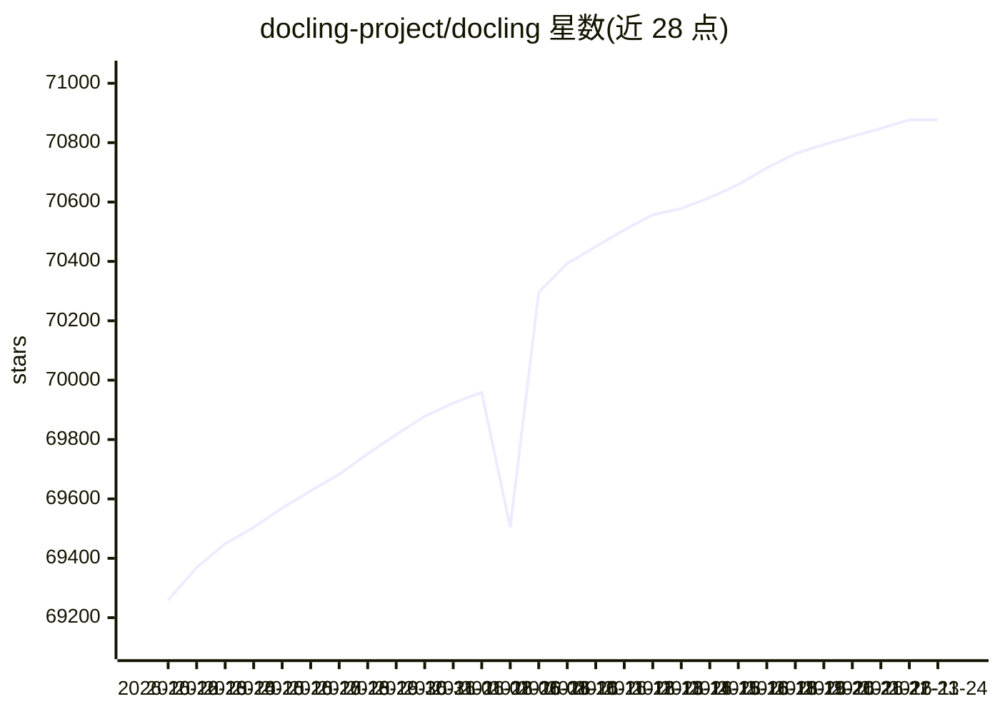

# docling-project/docling

⭐ 70,938 · Python · MIT · 推送 2026-11-23 · [GitHub](https://github.com/docling-project/docling) · [官网](https://docling-project.github.io/docling) · 组织维护

**为生成式 AI 准备文档的解析转换库**

多格式文档解析库：支持 PDF、DOCX、PPTX、HTML、EPUB、音频（WAV/MP3）、图片、邮件等格式的读取与结构化解析，内置版面、阅读顺序、表格结构、公式、OCR 与 ASR 模型，输出统一的 DoclingDocument 表示并可导出为 Markdown、HTML、JSON 等格式。通过 pip 安装，提供 CLI 与 Python API，可在本地或离线环境运行；面向需要把文档接入生成式 AI 应用的开发者，并提供 LangChain/LlamaIndex 等框架集成与 MCP server、API server（docling-serve）等运行方式。

## 筛选速览

| 维度 | 判定 | 备注 |
|---|---|---|
| AI 角色 | `ai-native` | 本体是模型或模型工具 |
| 许可风险 | `permissive` | MIT |
| 部署形态 | `library` | 以包/库形式分发 |
| 模型依赖 | — | README 未给出锁定关系 |
| 硬件要求 | — | 无带数字的原话,不猜 |
| 安装摩擦 | `low` | 无编译、无系统依赖或容器化 |
| 成熟度 | — | 结构信号不足 |

## 动量与使用信号

- 维护:`active` — 距上次 push 1.7 天,年发版 97,370 位贡献者
- 涨星:近 1 天 **+39**(自 20261016 起算)
- 安装:pypi 包 `docling` 月下载 2,909,751
- 平台:WINDOWS / MACOS / LINUX · 协议:MCP

## 能力要点

- 解析 PDF/DOCX/PPTX/HTML/EPUB/音频/图片等多种格式
- PDF 深度理解：版面、阅读顺序、表格结构、公式、OCR
- 统一的 DoclingDocument 表示与 Markdown/HTML/JSON 导出
- 提供 LangChain/LlamaIndex 集成、MCP server 与 docling-serve API 服务

## 适用场景

- 把 PDF/Office 文档转成 Markdown 或 JSON 供 LLM 应用使用
- 对扫描版 PDF 和图片做 OCR 提取
- 在离线/内网环境本地解析敏感文档
- 为 agent 应用提供文档读取能力（MCP）

## 场景标签

`文档解析` `OCR` · 领域:知识与检索

## 证据(README 行号)

> L27: Docling simplifies document processing by parsing diverse formats — including advanced PDF understanding — and prov
> L31: - 🗂️ Parsing of [multiple document formats][supported_formats] including PDF, DOCX, PPTX, XLSX, HTML, EPUB, Apple P
> L32: - 📑 Advanced PDF understanding incl. page layout, reading order, table structure, code, formulas, image classificat

## 星数曲线

2026-10-22 69,259 → 2026-11-24 70,877（+1,618）

---
*卡片 v1 · prompt 1.4 · 生成 2026-11-22 · 置信度 high · 依据 README sha `9720987b56f5` · [字段定义](../../DATASET.md)*
