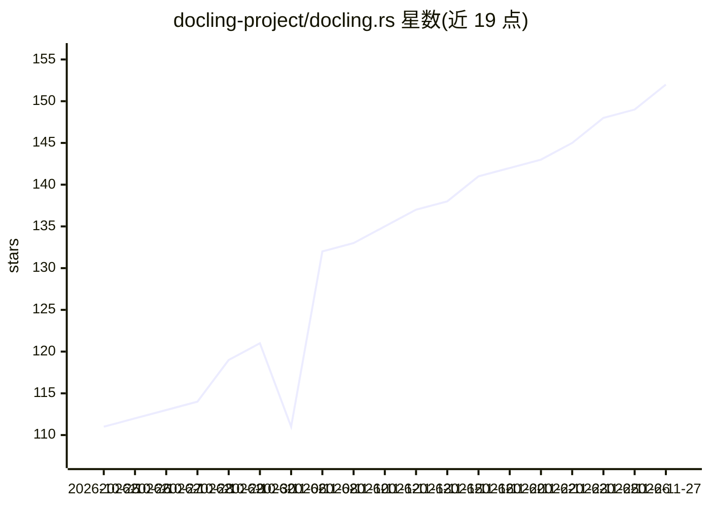

# docling-project/docling.rs

⭐ 152 · Rust · MIT · 推送 2026-11-26 · [GitHub](https://github.com/docling-project/docling.rs) · 组织维护

**Python docling 的 Rust 移植：单二进制把文档转成 LLM/RAG 可读格式**

docling.rs 将 PDF、Office、HTML、扫描件、音视频等文档转换为 Markdown、docling JSON、RAG chunks 等输出，供 LLM 与 RAG 管线读取。作为 IBM docling 的 Rust 移植，输出字节级一致，无 Python/PyTorch 依赖，以单一静态二进制分发，提供 CLI、Rust/Python/Node.js/wasm/C API、HTTP 服务端与 MCP 服务器。内置布局分析、表格识别（TableFormer）、OCR 与 Whisper 转录的 ONNX 模型（合计约 1 GB，需单独下载）。多 crate 需严格锁同版本升级。

## 筛选速览

| 维度 | 判定 | 备注 |
|---|---|---|
| AI 角色 | `ai-ecosystem` | LLM/agent 周边工具 |
| 许可风险 | `permissive` | MIT |
| 部署形态 | `desktop` | 安装包/桌面程序 |
| 模型依赖 | — | README 未给出锁定关系 |
| 硬件要求 | — | 无带数字的原话,不猜 |
| 安装摩擦 | `low` | 无编译、无系统依赖或容器化 |
| 成熟度 | — | 结构信号不足 |

## 能力要点

- 单一静态二进制运行 docling 同款模型，输出字节级一致
- CLI、Rust、Python、Node.js/Bun、wasm 浏览器端、C API 与 HTTP 服务端多语言入口
- docling-rs mcp 提供 MCP 服务器，供 Claude Desktop/Cursor 等调用转换工具
- 可选 GPU 加速：CUDA/TensorRT、DirectML、CoreML、WebGPU

## 适用场景

- 把 PDF、扫描件、Office 文档批量转成 Markdown 或 RAG chunks 喂给 LLM
- 用本地浏览器 wasm 版离线转换文档
- 给 AutoGen/LangChain/微软 Agent Framework 提供文档加载与索引
- 替换 docling-serve 作为 Open WebUI 的内容抽取引擎

## 场景标签

`文档解析` `语音识别` · 领域:知识与检索

## 证据(README 行号)

> L16: **docling.rs** converts documents — PDF, Office, HTML, scans, audio — into
> L17: Markdown, docling JSON and the other shapes an LLM or a RAG pipeline can
> L137:  `http://<host>:5001` — and n8n, Dify and LangChain clients work unchanged
> L159: - **RAG:** `docling-rag` — chunk, embed and search with a REST API and a web

## 星数曲线

2026-10-25 111 → 2026-11-27 152（+41）

---
*卡片 v1 · prompt 1.4 · 生成 2026-11-27 · 置信度 high · 依据 README sha `2d4cce39d6ac` · [字段定义](../../DATASET.md)*
