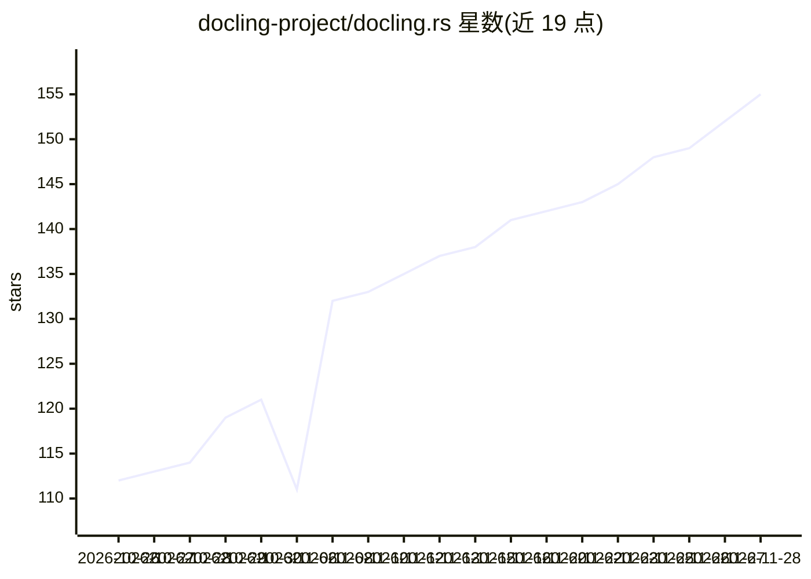

# docling-project/docling.rs

⭐ 155 · Rust · MIT · 推送 2026-11-27 · [GitHub](https://github.com/docling-project/docling.rs) · 组织维护

**给 LLM/RAG 管线做文档转换的 Rust 引擎**

docling.rs 将 PDF、Office、HTML、扫描件、音视频等文档转换为 Markdown、docling JSON、RAG chunks 等格式。它是 IBM docling 的 Rust 移植，输出与 Python 版逐字节一致，单一静态二进制运行，无 Python 与 PyTorch 依赖；PDF、图像与音频转换需加载 ONNX 模型（布局、OCR、TableFormer、Whisper，低于 1GB）。提供 CLI、Rust/Python/Node/WebAssembly 等 API、兼容 docling-serve 的 HTTP 服务器，以及 MCP 服务器与 LangChain/AutoGen 集成。

## 筛选速览

| 维度 | 判定 | 备注 |
|---|---|---|
| AI 角色 | `ai-native` | 本体是模型或模型工具 |
| 许可风险 | `permissive` | MIT |
| 部署形态 | `desktop` | 安装包/桌面程序 |
| 模型依赖 | — | README 未给出锁定关系 |
| 硬件要求 | — | 无带数字的原话,不猜 |
| 安装摩擦 | `low` | 无编译、无系统依赖或容器化 |
| 成熟度 | — | 结构信号不足 |

## 能力要点

- 单一静态二进制，输出与 Python docling 逐字节一致，无 Python/PyTorch
- 支持 PDF、Office、HTML、扫描件、音视频等格式，含布局分析、表格识别与 OCR
- 提供 CLI、Rust/Python/Node/wasm API、HTTP 服务器与 MCP 服务器多种接入面
- 内置 docling-rag 子系统与 LangChain/AutoGen/Microsoft Agent Framework 扩展

## 适用场景

- 为 RAG 管线批量转换文档并生成 chunks
- 在无 Python 环境中部署文档转换服务
- 通过 MCP 让 Claude Desktop 等客户端读取文档
- 浏览器本地转换文档（wasm，数据不出设备）

## 场景标签

`RAG` `文档解析` `OCR` · 领域:知识与检索

## 证据(README 行号)

> L16: **docling.rs** converts documents — PDF, Office, HTML, scans, audio — into
> L24: recognition and OCR. docling has the models for that, and a Python stack to
> L64: the ONNX models (layout, OCR, TableFormer, Whisper; under 1 GB): `install.sh`,

## 星数曲线

2026-10-26 112 → 2026-11-28 155（+43）

---
*卡片 v1 · prompt 1.4 · 生成 2026-11-28 · 置信度 high · 依据 README sha `33c51f77e2a2` · [字段定义](../../DATASET.md)*
