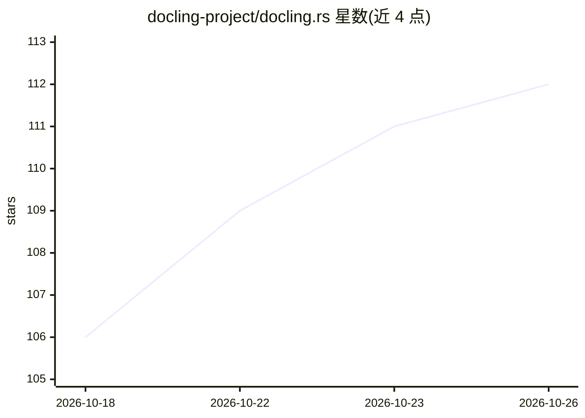

# docling-project/docling.rs

⭐ 112 · Rust · MIT · 推送 2026-10-25 · [GitHub](https://github.com/docling-project/docling.rs) · 组织维护

**Rust 版 docling：把 PDF/Office/HTML/音视频文档转成 Markdown/JSON 供 RAG 使用**

IBM docling 的完整 Rust 移植，单一静态二进制（或 pip/npm/crate）将 PDF、Office、HTML、扫描件、音频等转换为 Markdown、docling JSON、HTML、LaTeX、RAG chunks 等格式，内置布局分析、TableFormer、OCR 与本地 Whisper/Parakeet 语音转录等 ONNX 模型（<1GB）。提供 CLI、多语言绑定、HTTP 服务端与 MCP server，可注册自定义格式后端。面向构建 RAG/LLM 数据管线的开发者；Windows 需参考专门文档，视频帧抽取需另装 ffmpeg。

## 筛选速览

| 维度 | 判定 | 备注 |
|---|---|---|
| AI 角色 | `ai-native` | 本体是模型或模型工具 |
| 许可风险 | `permissive` | MIT |
| 部署形态 | `desktop` | 安装包/桌面程序 |
| 模型依赖 | — | README 未给出锁定关系 |
| 硬件要求 | — | 无带数字的原话,不猜 |
| 安装摩擦 | `low` | 无编译、无系统依赖或容器化 |
| 成熟度 | — | 结构信号不足 |

## 能力要点

- 单一二进制运行布局分析、TableFormer、OCR 与 Whisper 转录模型，无需 Python/PyTorch
- 输出 Markdown/docling JSON/LaTeX/Pandoc AST/WebVTT/RAG chunks 等，PDF 以外格式免模型
- 提供 docling-serve 兼容服务端，Open WebUI/n8n/Dify/LangChain 客户端可不改代码接入
- MCP server 供 Claude Desktop、Cursor、VS Code 等调用文档转换工具

## 适用场景

- RAG 入库前把 PDF/Office/HTML 统一转成保留结构与表格的 Markdown/JSON
- 通过 CLI 或 HTTP 服务批量转换目录树中的文档
- 用浏览器 wasm 版本在本地做文档转换与 OCR
- 为 Claude/Cursor 等 agent 提供文档转换 MCP 工具

## 场景标签

`文档解析` `RAG` · 领域:知识与检索

## 证据(README 行号)

> L16: **docling.rs** converts documents — PDF, Office, HTML, scans, audio — into
> L25: match. docling.rs runs the same models from a single binary: PDF 4.3× faster
> L63: Office, HTML, Markdown and e-mail need no models. PDF, images and audio need
> L64: the ONNX models (layout, OCR, TableFormer, Whisper; under 1 GB): `install.sh`,

## 星数曲线

2026-10-18 106 → 2026-10-26 112（+6）

---
*卡片 v1 · prompt 1.4 · 生成 2026-10-23 · 置信度 high · 依据 README sha `d980c43fef95` · [字段定义](../../DATASET.md)*
