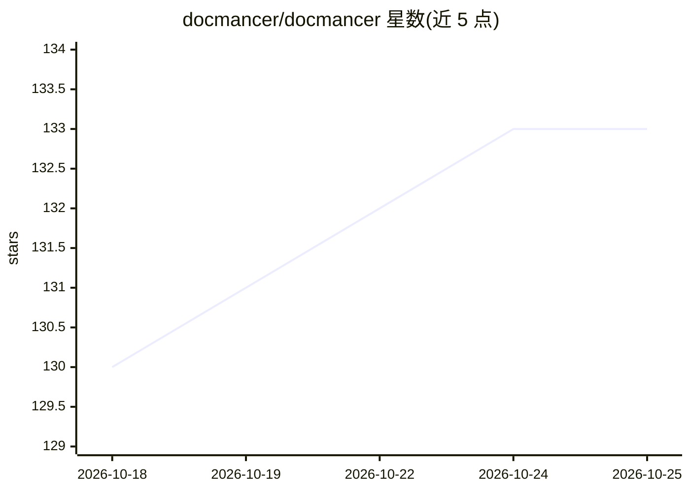

# docmancer/docmancer

⭐ 133 · Python · MIT · 推送 2026-08-13 · [GitHub](https://github.com/docmancer/docmancer) · [官网](https://docmancer.dev) · 组织维护

**索引并统一各 AI 编码代理的记忆与规则，跨机器备份恢复**

面向使用多个 AI 编码代理（Claude Code、Codex、Cursor、Gemini CLI 等）的开发者的 CLI 与本地 Web 工具：扫描本机各代理写入的 CLAUDE.md、AGENTS.md、规则文件与会话历史，建立带出处引用的索引，并把可沉淀的决策整理成普通 Markdown 的统一共享记忆，分发给所有已连接代理。提供加密备份/恢复、基于内容哈希的防覆盖编辑、审批式写入，默认本地离线运行（SQLite FTS5 + sqlite-vec + 内置 Model2Vec 模型），另有可选付费 Personal Sync 云同步。备份与恢复命令处于 development-preview 阶段。

## 筛选速览

| 维度 | 判定 | 备注 |
|---|---|---|
| AI 角色 | `ai-ecosystem` | LLM/agent 周边工具 |
| 许可风险 | `permissive` | MIT |
| 部署形态 | `library` | 以包/库形式分发 |
| 模型依赖 | — | README 未给出锁定关系 |
| 硬件要求 | — | 无带数字的原话,不猜 |
| 安装摩擦 | `low` | 无编译、无系统依赖或容器化 |
| 成熟度 | `idea` | |

## 能力要点

- 索引 Claude Code/Codex/Cursor 等代理写入的记忆、规则与会话历史并保留出处
- 统一为本地 Markdown 共享记忆，一次记录分发给所有已连接代理
- 短语加密本地备份/恢复，排除认证、.env、缓存等敏感内容
- 默认离线配置：SQLite FTS5 + sqlite-vec + 内置 embedding 模型，无需 API key

## 适用场景

- 在多个 AI 编码代理之间共享同一份项目决策与偏好记忆
- 换机器或上 VPS 时迁移各代理的会话历史与配置
- 查看每个代理实际收到了哪些上下文投影
- 检索某个技术决策是哪个代理在何时记录的

## 场景标签

`Agent 记忆` · 领域:Agent 开发

## 证据(README 行号)

> L60: 1. **I re-explain my project to every coding agent. How do I get them all working from the same context?** Docmance
> L97: **One memory instead of six.** Every supported agent reads from the same canonical Markdown, so a decision recorded
> L150: docmancer agent install claude-code --hooks

## 星数曲线

2026-10-18 130 → 2026-10-25 133（+3）

---
*卡片 v1 · prompt 1.4 · 生成 2026-10-22 · 置信度 high · 依据 README sha `3f1e6de8530d` · [字段定义](../../DATASET.md)*
