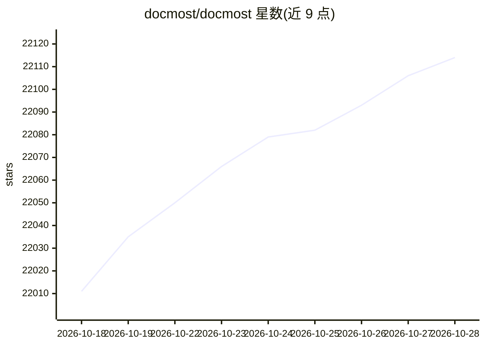

# docmost/docmost

⭐ 22,131 · TypeScript · AGPL-3.0 · 推送 2026-10-28 · [GitHub](https://github.com/docmost/docmost) · [官网](https://docmost.com) · 组织维护

**给团队提供的开源协作 wiki 与文档软件**

Docmost 是一个开源的协作 wiki 与文档软件，自称是 Confluence 和 Notion 的开源替代品。功能包括实时协作、图表绘制（Draw.io、Excalidraw、Mermaid）、空间管理、权限管理、群组、评论、页面历史、搜索、文件附件与嵌入（Airtable、Loom、Miro 等），支持 10+ 种语言翻译。可参考其文档自行部署，或使用官方提供的云版本。核心采用 AGPL 3.0 许可证。

## 筛选速览

| 维度 | 判定 | 备注 |
|---|---|---|
| AI 角色 | `ai-ecosystem` | LLM/agent 周边工具 |
| 许可风险 | `viral` | AGPL-3.0 |
| 部署形态 | `None` |  |
| 模型依赖 | — | README 未给出锁定关系 |
| 硬件要求 | — | 无带数字的原话,不猜 |
| 安装摩擦 | `low` | 无编译、无系统依赖或容器化 |
| 成熟度 | — | 结构信号不足 |

## 动量与使用信号

- 维护:`active` — 距上次 push 1.6 天,年发版 20,51 位贡献者
- 涨星:近 1 天 **+19**(自 20261016 起算)
- 下载:GitHub Release 附件 累计 1,180(60 个 release)

## 能力要点

- 实时协作编辑
- 支持 Draw.io、Excalidraw、Mermaid 图表
- 空间与权限管理、群组、页面历史
- 10+ 种语言翻译支持

## 适用场景

- 团队知识库与内部 wiki
- 项目与产品文档协作撰写
- 替代 Confluence/Notion 的自托管文档方案

## 场景标签

`知识库管理` · 领域:知识与检索

## 证据(README 行号)

> L3:  Open-source collaborative wiki and documentation software.
> L33: Docmost core is licensed under the open-source AGPL 3.0 license.

## 星数曲线

2026-10-18 22,011 → 2026-10-28 22,114（+103）

---
*卡片 v1 · prompt 1.4 · 生成 2026-10-18 · 置信度 mid · 依据 README sha `189587ab0d62` · [字段定义](../../DATASET.md)*
