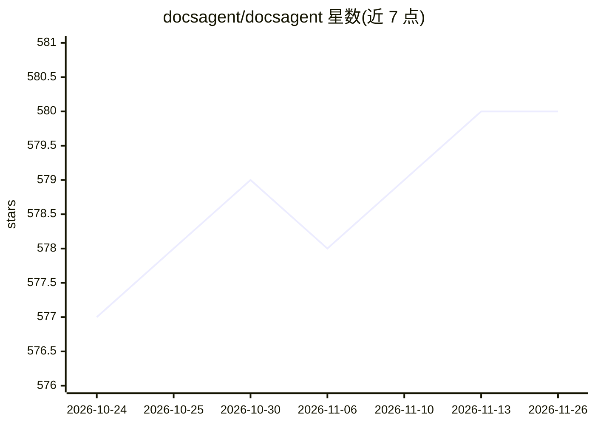

# docsagent/docsagent

⭐ 580 · TypeScript · 推送 2026-11-16 · [GitHub](https://github.com/docsagent/docsagent) · [官网](https://apps.apple.com/us/app/docsagent/id6829574595) · 组织维护

**MCP 服务器：让 AI agent 本地搜索 Zotero/Obsidian/Apple Notes**

提供 spec 驱动的 MCP 服务器（TypeScript 包 + 功能等同的 Python 包装），通过常驻 C++ 搜索引擎（BM25 倒排索引 + 段落排序）让 Claude Desktop、Cursor、Cline、Qwen Code 等 MCP 客户端搜索、读取、写入用户的 Zotero 库、Obsidian vault 与 Apple Notes。支持 stdio 与 Streamable HTTP 两种传输（后者带 API-key/OAuth2、RBAC），8 个 MCP 工具（5 读 3 写），写操作有三层安全门。另有 iPhone 应用（App Store，iOS 16+，未在中国大陆与欧盟上架）与 Mac 伴侣应用。基准为 1,506 篇 PDF 平均检索约 15 ms、内存 227 MB。

## 筛选速览

| 维度 | 判定 | 备注 |
|---|---|---|
| AI 角色 | `ai-ecosystem` | LLM/agent 周边工具 |
| 许可风险 | `none` | — |
| 部署形态 | `library` | 以包/库形式分发 |
| 模型依赖 | — | README 未给出锁定关系 |
| 硬件要求 | — | 无带数字的原话,不猜 |
| 安装摩擦 | `low` | 无编译、无系统依赖或容器化 |
| 成熟度 | — | 结构信号不足 |

## 能力要点

- Zotero/Obsidian/Apple Notes 三源统一查询，倒数排序融合（RRF k=60）
- 原生 C++ 引擎：1,500 篇 PDF 库约 15 ms 检索、160–227 MB 内存
- 8 个 MCP 工具，写操作三层安全门（开关/预览确认/每小时限额）
- npm 与 PyPI 双分发，macOS/Windows/Linux x64 捆绑核心二进制

## 适用场景

- 让 Claude Desktop/Cursor 直接检索我的 Zotero 文献库
- 本地私有环境向论文全文提问（配合 RAG）
- 通过 AI agent 批量整理 Zotero 条目、加标签与笔记

## 场景标签

`知识库管理` `科研工具` · 领域:知识与检索

## 证据(README 行号)

> L8: **`docsagent`** is the spec-driven **MCP (Model Context Protocol) server** that lets
> L9: any AI agent — Claude Desktop, Cursor, Cline, Qwen Code, or any MCP client — search, read, and
> L22: - 🌐 **Two transports** — stdio for local MCP clients, Streamable HTTP for remote deployment

## 星数曲线

2026-10-24 577 → 2026-11-26 580（+3）

---
*卡片 v1 · prompt 1.4 · 生成 2026-11-25 · 置信度 high · 依据 README sha `520f4ea74e16` · [字段定义](../../DATASET.md)*
