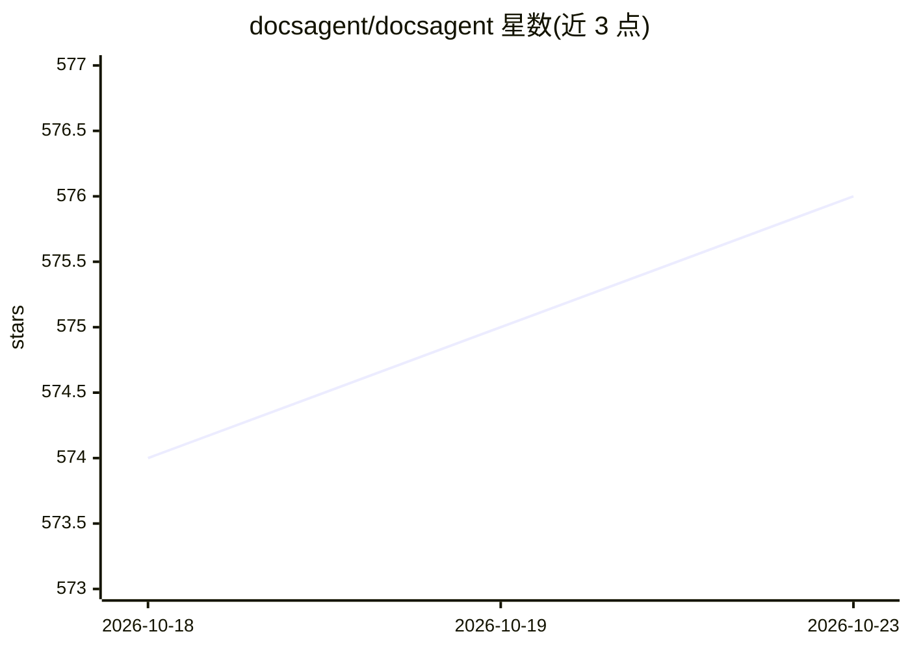

# docsagent/docsagent

⭐ 576 · TypeScript · 推送 2026-09-28 · [GitHub](https://github.com/docsagent/docsagent) · 组织维护

**让 AI agent 私密检索 Zotero/Obsidian/Apple Notes 的 MCP 服务器**

面向 Claude Desktop、Cursor、Cline、Qwen Code 等 MCP 客户端的本地优先知识库服务器：C++ 搜索核心提供 BM25 全文检索与查询排序的段落抽取，1000+ PDF 约 15 ms 检索，支持 Zotero/Obsidian/Apple Notes（macOS only）三源混合检索并用倒数排名融合（k=60）。提供 8 个 MCP 工具（5 读 3 写），写操作仅限 Zotero 且有三层安全门（开关/预览确认/每小时限速）。以 npm 包和本地构建的 Python wheel 分发，内置 macOS/Windows/Linux x64 核心，Linux ARM 不支持。

## 筛选速览

| 维度 | 判定 | 备注 |
|---|---|---|
| AI 角色 | `ai-ecosystem` | LLM/agent 周边工具 |
| 许可风险 | `none` | — |
| 部署形态 | `library` | 以包/库形式分发 |
| 模型依赖 | locked-api |  |
| 硬件要求 | — | 无带数字的原话,不猜 |
| 安装摩擦 | `low` | 无编译、无系统依赖或容器化 |
| 成熟度 | — | 结构信号不足 |

## 能力要点

- C++ 核心 BM25 检索 + 段落排序，约 15 ms，1,500 篇文献内存 160–227 MB
- Zotero/Obsidian/Apple Notes 三源混合检索，倒数排名融合（k=60）
- 8 个 MCP 工具，写操作三层安全门与每小时限速（默认 30 次）
- stdio 与 Streamable HTTP 双传输，支持 API-key/OAuth2 与 per-request RBAC

## 适用场景

- 让 Claude/Cursor 等 agent 直接检索我的 Zotero 文献库
- agent 读取并写入 Obsidian 笔记相关的 Zotero 注记（写仅限 Zotero）
- 远程部署 MCP 服务并按角色控制工具权限

## 场景标签

`RAG` `科研工具` · 领域:知识与检索

## 证据(README 行号)

> L4: **`docsagent`** is the spec-driven **MCP (Model Context Protocol) server** that lets
> L5: any AI agent — Claude Desktop, Cursor, Cline, Qwen Code, or any MCP client — search, read, and

## 星数曲线

2026-10-18 574 → 2026-10-23 576（+2）

---
*卡片 v1 · prompt 1.4 · 生成 2026-10-21 · 置信度 high · 依据 README sha `991f539d445a` · [字段定义](../../DATASET.md)*
