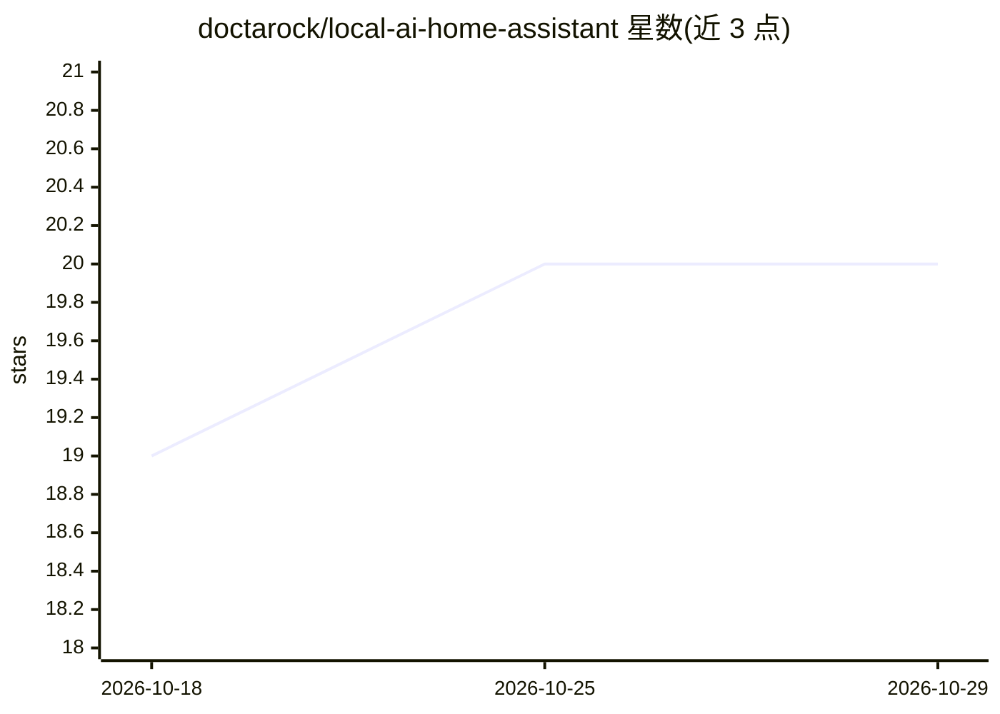

# doctarock/local-ai-home-assistant

⭐ 20 · JavaScript · GPL-3.0 · 推送 2026-07-27 · [GitHub](https://github.com/doctarock/local-ai-home-assistant) · [官网](https://derek.net.au) · 个人维护

**接入 Home Assistant 的本地自托管 AI 助手（Nova）**

隐私优先的自托管 AI 助手：以宿主机 Node.js 观察进程（nova-observer，node server.js）运行，经 Ollama 端点执行本地模型，LLM 工具调用隔离在 Docker 沙箱容器（只读文件系统、--cap-drop ALL、资源限制）中执行。功能覆盖自然语言分流与多专家路由、任务队列生命周期、语音接口与声纹信任门控、Qdrant 检索、工具治理与风险分级审批、运行时插件系统。面向自托管 Home Assistant 用户；README 声明界面不适用于开放 Web 暴露，语音安全准确性存疑。作者声明这是最后一个 Nova 界面版本，将转向 Omega 桌面项目。

## 筛选速览

| 维度 | 判定 | 备注 |
|---|---|---|
| AI 角色 | `ai-native` | 本体是模型或模型工具 |
| 许可风险 | `viral` | GPL-3.0 |
| 部署形态 | `self-host` | docker 或自建部署 |
| 模型依赖 | local-ok | 支持本地模型 |
| 硬件要求 | — | 无带数字的原话,不猜 |
| 安装摩擦 | `low` | 无编译、无系统依赖或容器化 |
| 成熟度 | `idea` | |

## 能力要点

- LLM 工具调用隔离于 Docker 沙箱（只读根文件系统、cap-drop ALL、PID/内存/CPU 限制）
- 跨本地与局域网 Ollama 端点的多大脑路由
- 声纹信任分级控制语音命令的允许/阻断
- 运行时插件系统与工具风险分级审批

## 适用场景

- 在本地网络用自然语言驱动 Home Assistant 设备自动化
- 自托管一个带任务队列与后台作业的私有 AI 助手
- 通过插件扩展助手能力（邮件、日历、浏览器等）

## 场景标签

`AI 助手` · 领域:对话与助手

## 证据(README 行号)

> L51: - Multi-specialist routing across local and remote Ollama endpoints
> L226: - A multi-brain routing layer across local and LAN Ollama endpoints
> L262: The LLM does not get host shell access directly. Tool execution is isolated in Docker.

## 星数曲线

2026-10-18 19 → 2026-10-29 20（+1）

---
*卡片 v1 · prompt 1.4 · 生成 2026-10-28 · 置信度 high · 依据 README sha `9be50890539b` · [字段定义](../../DATASET.md)*
