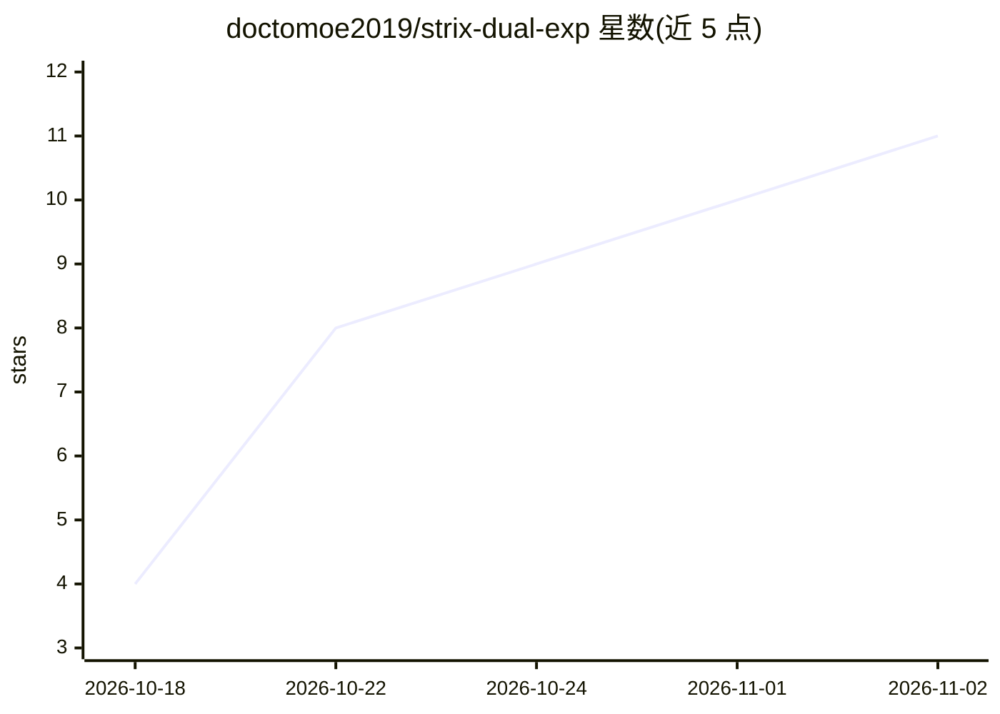

# doctomoe2019/strix-dual-exp

⭐ 11 · C · MIT · 推送 2026-10-22 · [GitHub](https://github.com/doctomoe2019/strix-dual-exp) · 个人维护

**双 AMD Strix Halo 主机经 USB4v2 做张量并行 LLM 推理的实验仓库**

记录在两台 AMD Strix Halo 迷你主机间通过 USB4v2（Barlow Ridge NHI）搭建双机 TP2 张量并行 LLM 服务（gufo）的完整工程：自制 out-of-tree 内核模块 thunderbolt_stream 将 Linux USB4 XDomain 协议改造为帧式、端到端流控的 DMA 环对，跨 rank 流量不经网卡与内核 IP 栈；含链路 wedge 触发根因修复与约 8 秒自治自愈。开发验证模型为 Qwen3.8-Flash-Next Q4/Q8。SETUP.md 提供从内核模块、gufo 构建到性能测量的逐步复现指南，需专用双机硬件与内核编译，面向高端本地推理实验者。

## 筛选速览

| 维度 | 判定 | 备注 |
|---|---|---|
| AI 角色 | `ai-ecosystem` | LLM/agent 周边工具 |
| 许可风险 | `permissive` | MIT |
| 部署形态 | `None` |  |
| 模型依赖 | — | README 未给出锁定关系 |
| 硬件要求 | — | 无带数字的原话,不猜 |
| 安装摩擦 | `low` | 无编译、无系统依赖或容器化 |
| 成熟度 | — | 结构信号不足 |

## 能力要点

- thunderbolt_stream 内核模块：USB4 XDomain 上的帧式 DMA 环与 E2E 流控，10 KiB 交换 p50 22–23 µs，调优后约 5 GB/s 线速
- gufo TP2 全部跨 rank 流量走流传输，~62k 上下文 prefill 2330 tok/s、MTP 解码 68.6–73.2 tok/s（双机）
- 容量解锁：Q8 @262144 上下文分片加载约 36 秒，单台 122 GB 主机无法容纳
- 链路自愈：检测、强制断链重训、重枚举约 8 秒内自治完成，服务不中断

## 适用场景

- 用两台 Strix Halo 迷你主机分片运行单机装不下的大上下文模型
- 研究 USB4/雷電主机互联替代网卡做张量并行的可行性与性能
- 参考其测量驱动的方法做推理 decode 优化实验

## 场景标签

`推理引擎` · 领域:训练与推理

## 证据(README 行号)

> L26: - Kernel side: an out-of-tree `thunderbolt_stream` module (built from
> L53: **2. gufo serving over it** — two-rank tensor parallelism with all

## 星数曲线

2026-10-18 4 → 2026-11-02 11（+7）

---
*卡片 v1 · prompt 1.4 · 生成 2026-11-02 · 置信度 high · 依据 README sha `d0a73b28f881` · [字段定义](../../DATASET.md)*
