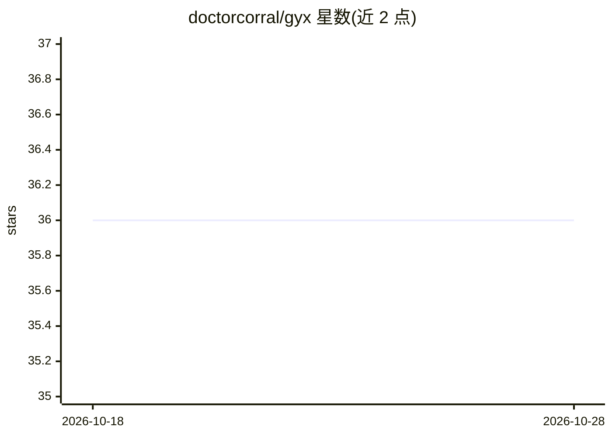

# doctorcorral/gyx

⭐ 36 · Elixir · BSD-2-Clause · 推送 2026-09-19 · [GitHub](https://github.com/doctorcorral/gyx) · [官网](https://gyx.ai) · 个人维护

**Elixir 原生强化学习环境与训练库，兼容 Gymnasium 接口**

用 Elixir 实现的强化学习环境库与训练器：环境遵循 Gymnasium 风格契约（make/reset/step/render），包含经典控制、FrozenLake、Blackjack 等纯 Elixir 环境，以及基于 Nx/EXLA 的 MuJoCo 刚体物理环境；提供 Q-learning、SARSA、REINFORCE、A2C、PPO 训练算法（后两者基于 Axon+Nx）。可选通过 Python Port 接入真实 MuJoCo/Atari。以 Hex 包发布，附带 mix gyx.* CLI 与独立 Phoenix playground（UI 不随包发布）。

## 筛选速览

| 维度 | 判定 | 备注 |
|---|---|---|
| AI 角色 | `ai-native` | 本体是模型或模型工具 |
| 许可风险 | `permissive` | BSD-2-Clause |
| 部署形态 | `None` |  |
| 模型依赖 | — | README 未给出锁定关系 |
| 硬件要求 | — | 无带数字的原话,不猜 |
| 安装摩擦 | `low` | 无编译、无系统依赖或容器化 |
| 成熟度 | — | 结构信号不足 |

## 能力要点

- Gymnasium 风格契约的纯 Elixir 环境实现（经典控制/MuJoCo/近似 tree）
- Q-learning/SARSA/REINFORCE/A2C/PPO 训练器与预设
- gymnasium/ 前缀通过 Python Port 接入真实 MuJoCo 与 ALE Atari
- mix gyx.* CLI（训练/实验/交互/基准）与可选 Phoenix playground

## 适用场景

- 在 Elixir/BEAM 上直接训练与评测强化学习策略
- 无需 Python 即可运行经典控制与近似 MuJoCo 环境
- 把训练好的 Gyx 策略放到真实 MuJoCo C 引擎上评估

## 场景标签

`强化学习` · 领域:训练与推理

## 证据(README 行号)

> L5: Native Elixir reinforcement learning. Environments follow a
> L6: Gymnasium-shaped contract (`make` / `reset` / `step` / `render`) and
> L224: `Gyx.Agent` is the protocol (`act`, `learn`, `finish_episode`, `eval`).

## 星数曲线

2026-10-18 36 → 2026-10-28 36（+0）

---
*卡片 v1 · prompt 1.4 · 生成 2026-10-25 · 置信度 high · 依据 README sha `7cddeffec705` · [字段定义](../../DATASET.md)*
