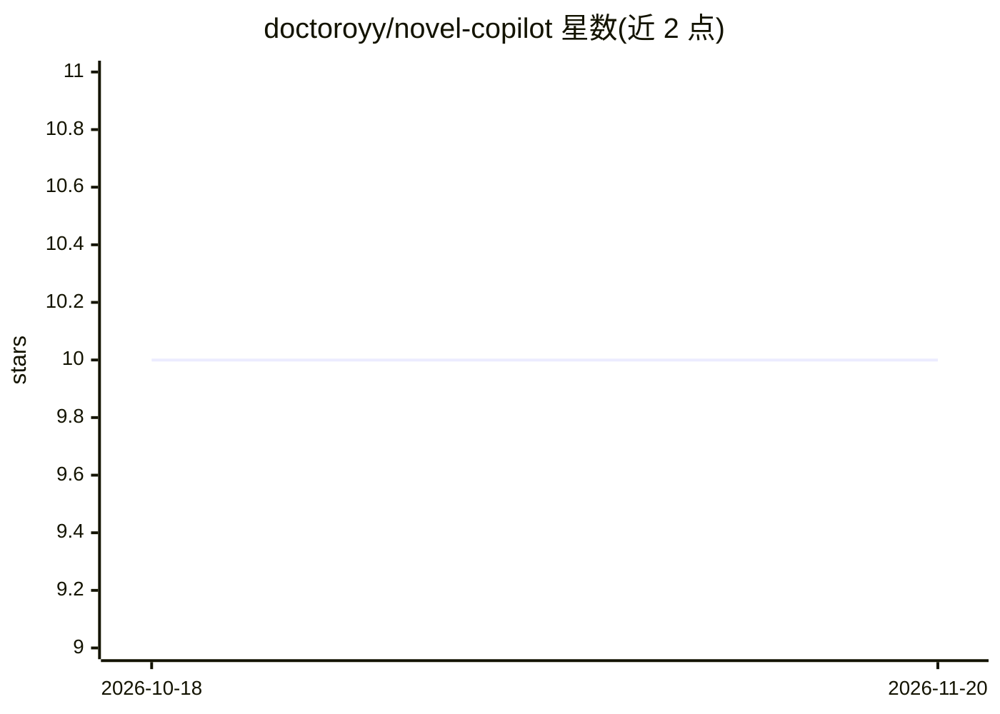

# doctoroyy/novel-copilot

⭐ 10 · TypeScript · MIT · 推送 2026-11-06 · [GitHub](https://github.com/doctoroyy/novel-copilot) · [官网](https://novel-copilot.doctoroyy.net/) · 个人维护 · 中文 README

**面向小说作者的 AI 写作平台，生成章节并维护剧情一致性**

基于 Cloudflare Workers 与 Hono 的全栈小说创作平台，提供 Web 与 React Native 客户端。功能包括大纲生成、单章/批量章节生成（SSE 流式与后台任务）、Story Bible 生成与编辑、角色关系图、ZIP 导出。通过三层记忆（Story Bible、滚动摘要、近期章节）加上剧情图、叙事控制、多维度 QC、语义缓存、时间线追踪等阶段机制维持剧情一致性与质量检查。依赖 Cloudflare 账号与 D1 数据库部署，模型经由 Gemini/OpenAI/DeepSeek 等外部 API 提供。

## 筛选速览

| 维度 | 判定 | 备注 |
|---|---|---|
| AI 角色 | `ai-native` | 本体是模型或模型工具 |
| 许可风险 | `permissive` | MIT |
| 部署形态 | `library` | 以包/库形式分发 |
| 模型依赖 | — | README 未给出锁定关系 |
| 硬件要求 | — | 无带数字的原话,不猜 |
| 安装摩擦 | `low` | 无编译、无系统依赖或容器化 |
| 成熟度 | — | 结构信号不足 |

## 能力要点

- 三层记忆系统：Story Bible + 滚动摘要 + 近期章节
- 六阶段上下文工程：剧情图、叙事控制、多维度 QC、语义缓存、时间线追踪
- 批量章节生成以持久化后台任务运行，支持取消与状态查询端点
- Web 与 React Native 移动端客户端，CI 自动发布 Android APK 与 iOS IPA

## 适用场景

- 用 AI 生成小说大纲与章节内容
- 长篇连载中维护角色状态与剧情一致性
- 一键部署到 Cloudflare 搭建个人写作平台

## 场景标签

`AI 写作` · 领域:内容生成

## 证据(README 行号)

> L28: - Single chapter generation (SSE stream)
> L37: |Base|Story Bible|World, rules, setting, constraints|
> L169: ```bash

## 星数曲线



2026-10-18 10 → 2026-11-20 10（+0）


---
*卡片 v1 · prompt 1.4 · 生成 2026-11-19 · 置信度 mid · 依据 README sha `86341ea7f726` · [字段定义](../../DATASET.md)*
