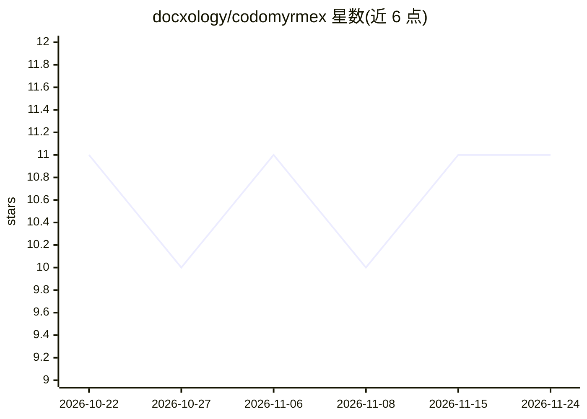

# docxology/codomyrmex

⭐ 11 · Python · MIT · 推送 2026-11-22 · [GitHub](https://github.com/docxology/codomyrmex) · [官网](https://doi.org/10.5281/zenodo.21750800) · 个人维护

**模块化 Python 智能体平台：以 MCP 工具形式暴露 LLM 代理与工程能力**

Codomyrmex 是一个模块化 Python 工作区，包含 132 个顶层模块，覆盖 AI 代理、云基础设施、安全、多媒体等 10 个能力层。核心机制是通过 @mcp_tool 装饰器将 622 个运行时工具暴露给任意 Model Context Protocol 客户端（Claude、Gemini、GPT 等）；包含多提供商代理框架、graph RAG、向量存储、静态分析、Git 操作、容器与部署编排等模块。采用 uv 管理依赖，实施零模拟（Zero-Mock）测试策略，需通过 git clone 与 uv sync 安装。

## 筛选速览

| 维度 | 判定 | 备注 |
|---|---|---|
| AI 角色 | `ai-ecosystem` | LLM/agent 周边工具 |
| 许可风险 | `permissive` | MIT |
| 部署形态 | `library` | 以包/库形式分发 |
| 模型依赖 | locked-api |  |
| 硬件要求 | — | 无带数字的原话,不猜 |
| 安装摩擦 | `low` | 无编译、无系统依赖或容器化 |
| 成熟度 | — | 结构信号不足 |

## 能力要点

- 622 个运行时 MCP 工具，供任意 MCP 客户端调用
- 多提供商代理框架（Claude、Gemini、GPT-4o、DeepSeek 等 13+ 提供商）
- 132 个顶层模块跨 10 个能力层，含 graph RAG 与向量存储（FAISS/ChromaDB）
- uv 管理、零模拟测试策略、37,248 个收集测试

## 适用场景

- 为 MCP 客户端搭建本地工具服务器与多代理编排
- 构建代码生成、重构与分析的代理工作流
- 搭建含图检索增强生成（graph RAG）的个人 AI 基础设施
- 统一管理云部署、容器与 Git 操作的自动化流水线

## 场景标签

`编码 Agent` `多智能体` `RAG` `Agent 框架` · 领域:Agent 开发

## 证据(README 行号)

> L32: Codomyrmex is a modular library of **132 top-level modules** under `src/codomyrmex/` spanning AI agents, cloud infr
> L55: |🎛️ **13+ Agent Providers**|Claude, Gemini, GPT-4o, DeepSeek, Mistral, Jules, Codex, Pi, and more|
> L120: |`model_context_protocol`|29|15|📖|⚙️|📜|MCP tool server, bridge, and protocol implementation|

## 星数曲线

2026-10-22 11 → 2026-11-24 11（+0）

---
*卡片 v1 · prompt 1.4 · 生成 2026-11-18 · 置信度 mid · 依据 README sha `3a980b0e00b9` · [字段定义](../../DATASET.md)*
