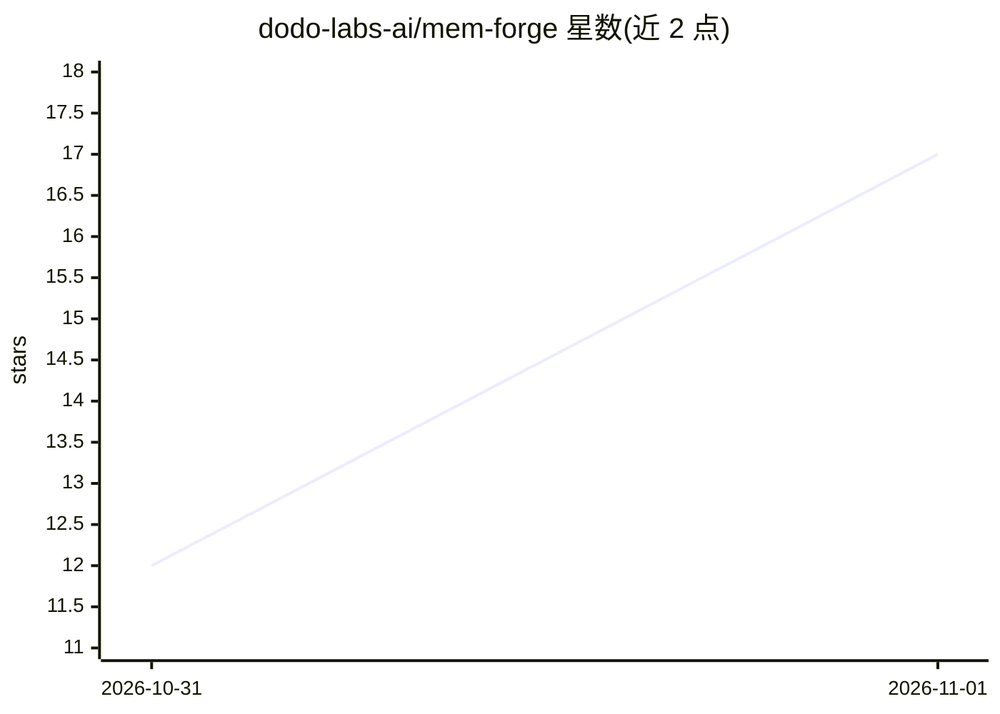

# dodo-labs-ai/mem-forge

⭐ 17 · Python · NOASSERTION · 推送 2026-10-31 · [GitHub](https://github.com/dodo-labs-ai/mem-forge) · 组织维护

**给 AI agent 的团队记忆层：把文档/工单/聊天变成可溯源记忆**

自托管的 agent 记忆层：连接 Notion、Confluence、Jira、GitHub、Teams 等来源，经同步抽取为带引用的短记忆存储于本地（SQLite/FTS5/Chroma）；来源更新后对相关记忆做保留、替换或退役并链接版本关系；agent 通过 MCP 检索记忆并打开原始出处，提供 Claude Code 与 Codex 插件。需 Docker Compose 与 OpenRouter/OpenAI/Anthropic 的模型 key。开源版限单人单机、仅监听 127.0.0.1、无账号认证，处于 beta。

## 筛选速览

| 维度 | 判定 | 备注 |
|---|---|---|
| AI 角色 | `ai-ecosystem` | LLM/agent 周边工具 |
| 许可风险 | `permissive` | NOASSERTION |
| 部署形态 | `self-host` | docker 或自建部署 |
| 模型依赖 | locked-api |  |
| 硬件要求 | — | 无带数字的原话,不猜 |
| 安装摩擦 | `low` | 无编译、无系统依赖或容器化 |
| 成熟度 | `idea` | |

## 能力要点

- 连接 Confluence/Notion/Jira/GitHub/Teams 同步抽取带引用的记忆
- 来源变更后记忆自动复核（保留/替换/退役）并保留历史版本
- 本地存储（SQLite/FTS5/Chroma），自带模型 key，插件不上传会话记录
- Claude Code 与 Codex 插件经 MCP 检索记忆并引用来源

## 适用场景

- 让编码 agent 在改代码前先查团队既有决策与惯例
- 把散落在 Notion/Confluence/Jira 的团队知识变成 agent 可引用的记忆
- 文档更新后自动维护 agent 记忆的新旧版本关系

## 场景标签

`Agent 记忆` `知识库管理` · 领域:Agent 开发

## 证据(README 行号)

> L130: 4. **Recall.** Agents search memory and open its sources over MCP.

## 星数曲线

2026-10-31 12 → 2026-11-01 17（+5）

---
*卡片 v1 · prompt 1.4 · 生成 2026-10-31 · 置信度 high · 依据 README sha `31b518807179` · [字段定义](../../DATASET.md)*
