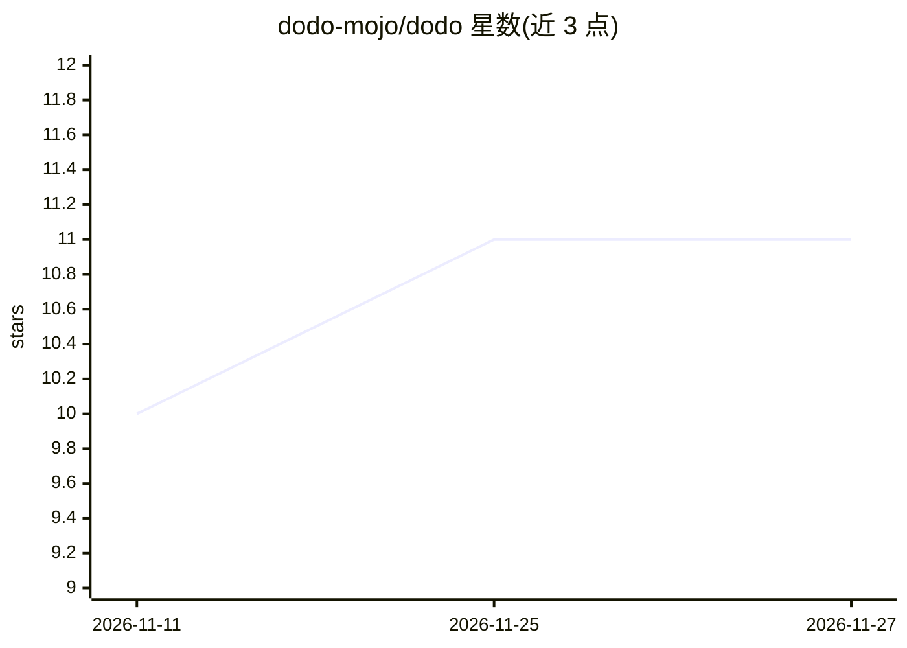

# dodo-mojo/dodo

⭐ 11 · Mojo · Apache-2.0 · 推送 2026-11-22 · [GitHub](https://github.com/dodo-mojo/dodo) · 个人维护

**Mojo 语言的 Web 框架，同一进程内置 AI/GPU/视觉能力**

用 Mojo 编写的 Web 框架，路由、类型化提取器、JSON、中间件、SSE、WebSocket、HTTP/1.1、HTTP/2、TLS 均在规划能力内；同一进程内提供 MAX 模型服务（请求批处理与 token 流式输出）、Mojo GPU 内核（NVIDIA/AMD/Apple）、图像视频解码与检测/OCR 推理，以及 agent 工具链（模型客户端、MCP client/server、evals、traces）。默认单进程运行无胶水服务，需要隔离或独立扩缩时可迁移到受监督 worker 或外部 AI 服务而无需重写。当前为 pre-alpha，仅网络核心、App API、数据库驱动和 CLI 经测试，尚无稳定 API。

## 筛选速览

| 维度 | 判定 | 备注 |
|---|---|---|
| AI 角色 | `ai-enhanced` | 去掉 AI 部分产品仍成立 |
| 许可风险 | `permissive` | Apache-2.0 |
| 部署形态 | `None` |  |
| 模型依赖 | — | README 未给出锁定关系 |
| 硬件要求 | — | 无带数字的原话,不猜 |
| 安装摩擦 | `low` | 无编译、无系统依赖或容器化 |
| 成熟度 | `idea` | |

## 能力要点

- 同一进程内服务 MAX 模型：请求批处理与 token 流式输出
- 在请求处理中运行 Mojo GPU 内核，支持 NVIDIA、AMD、Apple
- 内置 agent 工具链：模型客户端、MCP client/server、evals、traces
- 每个 CLI 命令支持 --json，自带 MCP server

## 适用场景

- 在单个服务里同时提供 Web 接口和 AI 推理
- 对请求数据直接运行 GPU 视觉处理管线
- 用 Mojo 构建带工具调用与评测追踪的 agent 服务

## 场景标签

 · 领域:Web 开发/软件框架

## 证据(README 行号)

> L3: A Mojo web framework with AI, GPU kernels, computer vision and agents natively supported, all in one language.
> L13: - **Web.** Router, typed extractors, JSON, middleware, static files, SSE, WebSockets, HTTP/1.1, HTTP/2, TLS.

## 星数曲线

2026-11-11 10 → 2026-11-27 11（+1）

---
*卡片 v1 · prompt 1.4 · 生成 2026-11-19 · 置信度 high · 依据 README sha `857e1c36e4c6` · [字段定义](../../DATASET.md)*
