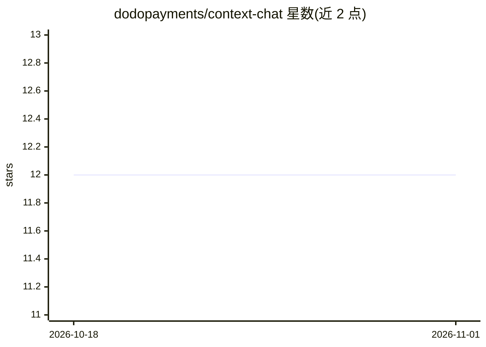

# dodopayments/context-chat

⭐ 12 · TypeScript · Apache-2.0 · 推送 2026-10-30 · [GitHub](https://github.com/dodopayments/context-chat) · [官网](https://contextmcp.ai) · 组织维护

**可嵌入文档站的自托管 AI 问答组件，带引用与防滥用**

部署为单个 Cloudflare Worker 的自托管文档问答组件：通过一个 script 标签嵌入任意网站，从搜索后端（默认 ContextMCP，也可用 http-json/http-markdown 适配器接入自有端点）检索文档片段，调用 OpenAI API 流式输出带行内引用的回答。面向希望给文档站加“Ask AI”的开发者/团队。采用六层防滥用机制（WAF 限速、Turnstile、Workers ratelimits、GlobalBudgetDO 全局配额、AI Gateway 花费上限、代码内 token/检索上限）保护公开端点。Apache-2.0 许可，需自备 OpenAI API key（BYOK）并可经 AI Gateway 认证替代。

## 筛选速览

| 维度 | 判定 | 备注 |
|---|---|---|
| AI 角色 | `ai-native` | 本体是模型或模型工具 |
| 许可风险 | `permissive` | Apache-2.0 |
| 部署形态 | `library` | 以包/库形式分发 |
| 模型依赖 | — | README 未给出锁定关系 |
| 硬件要求 | — | 无带数字的原话,不猜 |
| 安装摩擦 | `low` | 无编译、无系统依赖或容器化 |
| 成熟度 | — | 结构信号不足 |

## 能力要点

- 单个 Cloudflare Worker 部署，script 标签一键嵌入
- 三种检索适配器：contextmcp / http-json / http-markdown
- 六层防滥用栈：WAF、Turnstile、限速、全局请求/token 配额、花费上限
- Shadow DOM 隔离的 React 组件，支持明暗主题与 CSS token 覆盖

## 适用场景

- 给文档站加一个引用原文的 Ask AI 助手
- 接入已有的文档搜索端点提供流式问答
- 在公开网站安全地暴露 AI 问答端点而不被刷 token

## 场景标签

`文档问答` `聊天机器人` · 领域:对话与助手

## 证据(README 行号)

> L3: **An embeddable, self-hosted AI chat widget for your documentation.** Drop an "Ask AI"
> L5: single Cloudflare Worker that retrieves relevant docs from your search backend, then streams
> L6: an **OpenAI** answer with inline citations — behind a **layered abuse-control** stack so a

## 星数曲线

2026-10-18 12 → 2026-11-01 12（+0）

---
*卡片 v1 · prompt 1.4 · 生成 2026-11-01 · 置信度 high · 依据 README sha `a9e441fdbec0` · [字段定义](../../DATASET.md)*
